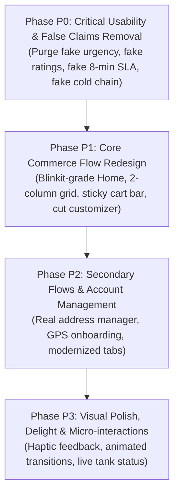

# PONDFISH Customer Mobile App — UI/UX Engineering Audit & Design System Specification

**Target Application:** `customer-app/`  
**Repository:** `https://github.com/sprojectxx/POND_FISH`  
**Approved Baseline / Current HEAD:** `58f274fd7af9e1b472fc3964ef40ebb8b7810cf8`  
**Audit Date:** November 3, 2026  
**Auditor:** Antigravity Mobile UI/UX & Systems Architecture Engineering  

---

## 1. Executive Summary & Blinkit-Grade Benchmarking

### 1.1 Executive Summary
The PondFish customer mobile application is a React Native Android application (React 18.3.1, React Native 0.75.4) built to serve retail fresh-fish commerce, customer subscriptions, counter bill scanning, and order reservations. While the application possesses solid low-level security foundations (including strict token-tombstone handling, credential sanitization, and bounded connection pooling), its user interface and interaction architecture fall significantly short of modern consumer commerce standards.

The current user experience suffers from five fundamental structural defects:
1. **Severe Visual Clutter & Misplaced Priorities**: The primary discovery surface (`HomeScreen.jsx`, 2,315 lines) forces users through a gauntlet of five unvirtualized promotional banners, subscription quota summaries, and harbor truck animations before revealing a single product.
2. **Fabricated Commerce Tropes (Dark Patterns)**: Hardcoded `★ 4.8` ratings, fake `(1,420)` review counts, artificial `⚡ 8 mins` delivery promises, fake urgency countdowns (`⏱ Ends in 03h:24m`), and deceptive `Continuous 0-4°C Cold Chain` banners undermine brand integrity and contradict PondFish’s genuine identity as a live-tank, fresh-cut retail business.
3. **Monolithic Custom Navigation State Machine**: Instead of using an industry-standard navigation stack (such as React Navigation), `App.jsx` orchestrates screens via a 723-line monolithic state machine (`currentScreen` string state). This produces fragile back-handler interception, prevents deep-linking, breaks nested stack transitions, and limits bottom navigation to a rigid, emoji-based 5-item bar.
4. **Missing Commerce Primitives**: The app lacks a sticky cart summary bar, has no interactive cut/cleaning yield visualizer, lacks address management (using hardcoded strings like "Flat 302, Madhapur, Hyd"), and provides no GPS or reverse-geocoded location onboarding.
5. **Performance & Viewport Inefficiencies**: Critical list components use flex-wrap percentage widths (`width: '48%'`) instead of virtualized `FlatList` column grids with `getItemLayout`, causing layout recalculations and unbounded memory consumption.

### 1.2 Blinkit-Grade Benchmarking
To bring PondFish up to the benchmark established by tier-1 quick-commerce applications (such as Blinkit, Zepto, and Instamart) while remaining strictly tailored to the live-fish retail trade, the following delta must be addressed:

| Benchmark Dimension | Modern Quick Commerce (Blinkit Standard) | Current PondFish Customer App (`customer-app`) | Target PondFish Standard |
| :--- | :--- | :--- | :--- |
| **Initial Viewport** | 4–6 products visible immediately on launch; compact 2-column grid. | 0 products visible. 100% of the initial 800dp viewport is consumed by banners, quotas, and truck cards. | 4 products immediately visible below a compact location/search header. |
| **Product Discovery** | Direct, high-contrast imagery, clear price per kg, instant `ADD` or `− 1 +` stepper. | Generic fish card with fake `★ 4.8`, fake `8 mins`, non-stepper `+ ADD` button, no weight/yield notes. | 2-column compact grid, live tank status badge, price per kg, gross vs net yield note, inline stepper. |
| **Customization** | Instant bottom sheet for weight/cut selection without leaving browsing context. | Redirects to a heavy 1,124-line details screen; cut choices do not update live net weight or price. | Lightweight bottom sheet showing cuts (Curry Cut, Bengali, Steaks, Fillet) and dynamic yield calculator. |
| **Cart Interaction** | Persistent floating sticky cart bar at viewport bottom (`3 items • ₹640 [View Cart]`). | No floating cart bar. Cart count is hidden in a small top header icon (`CartBadgeButton`) on 2 screens only. | Global sticky cart bar sliding up smoothly when `items.length > 0`, anchored above bottom navigation. |
| **Navigation Architecture** | Native stack navigation (`@react-navigation/native`), hardware transitions, deep linking. | String-state conditional rendering in `App.jsx`, manually wired back button handler. | Standard React Navigation stack with bottom tab navigator and shared element transitions. |
| **Operational Honesty** | Accurate delivery windows based on real courier routing and warehouse packing times. | Claims "⚡ 8 mins" and "Continuous 0-4°C Cold Chain" despite being a counter-cut store business. | Honest preparation windows ("Ready for pickup in 25 mins" / "Local delivery in 45–60 mins"). |
| **Location & Address** | Instant GPS auto-detect, reverse-geocoded street address, saved address switcher. | None. Single freeform `area` string in profile. Address in checkout is hardcoded dummy text. | GPS permission, reverse geocoding proxy, structured address cards (`House`, `Street`, `Landmark`). |

---

## 2. Screen-by-Screen UI/UX Audit

This audit evaluates all 20 screens and 6 shared components currently implemented in `customer-app/`. Each screen is evaluated against 8 core dimensions on a 1–10 scale:
- **VH**: Visual Hierarchy
- **TY**: Typography & Legibility
- **SP**: Spacing & 4px Grid Alignment
- **CS**: Design Token Consistency
- **NV**: Navigation & Screen Transitions
- **AX**: Accessibility & Touch Target Health ($\ge 44 \times 44\text{ dp}$)
- **IQ**: Interaction Quality & State Feedback
- **PR**: Performance & Virtualization Readiness
- **OVR**: Overall Screen Score (Weighted Average)

---

### 2.1 `App.jsx` (Application Orchestrator & Navigation Shell)
- **File**: `customer-app/App.jsx` (723 lines)
- **Purpose**: Authenticated application root, navigation state machine, Android hardware back-button interceptor, global auth guard, and 5-tab bottom navigation bar.
- **Visual Hierarchy Assessment**:
  The bottom navigation bar occupies 56dp at the bottom. However, navigation items use raw Unicode emoji glyphs (`🏪`, `🧭`, `▣`, `📅`, `👤`), which render inconsistently across Android OEM skins (Samsung OneUI vs Stock Android vs Xiaomi MIUI). The elevated center `Scan Bill` button (`▣`) dominates the visual hierarchy, prioritizing physical counter receipt scanning over primary fish browsing.
- **Typography & Spacing Assessment**:
  Font sizes are hardcoded (`fontSize: 10` for labels, `fontSize: 16` for icons). Active state labels turn `#16A34A` (green), while inactive labels remain `#64748B` (slate).
- **Interaction & State Handling Assessment**:
  Uses manual conditional rendering (`{currentScreen === 'HOME' && <HomeScreen ... />}`). Screen transitions are instantaneous without native transition animations. If a user presses back, a sprawling 50-line `BackHandler` switch statement decides whether to exit or redirect.
- **Accessibility & Touch Target Compliance**:
  Navigation items measure ~40dp width on narrow viewports, violating the 48dp minimum navigation tap target. Lacks `accessibilityRole="tab"` and `accessibilityState={{ selected: currentScreen === tab }}`.
- **Performance & Health**:
  Unmounted screens lose their internal state completely when switched, causing fresh API re-fetches upon return unless cached in API service.
- **Concrete Defects**:
  - `App.jsx:465-520`: Emojis (`🏪`, `🧭`, `▣`, `📅`, `👤`) used as navigation icons instead of vector icons or SVG glyphs.
  - `App.jsx:472-484`: "Track" is given top-level bottom tab space, despite being useful only when an order is in transit.
  - `App.jsx:83`: `CART_AWARE_SCREENS` only includes `['HOME', 'FISH_DETAILS']`, leaving `Categories`, `LiveTracking`, and `Profile` completely unaware of active cart contents.
- **Actionable Redesign Recommendations**:
  1. Migrate to `@react-navigation/bottom-tabs` and `@react-navigation/native-stack`.
  2. Reorder bottom tabs to standard commerce flow: `Store`, `Categories/Search`, `Orders`, `Subscription`, `Profile`.
  3. Replace raw emojis with crisp SVG icons.
- **Scores**:
  - VH: 4/10 | TY: 5/10 | SP: 6/10 | CS: 5/10 | NV: 4/10 | AX: 4/10 | IQ: 4/10 | PR: 6/10 | **OVR: 4.8/10**

---

### 2.2 `HomeScreen.jsx` (Customer Dashboard & Primary Catalogue)
- **File**: `customer-app/src/screens/HomeScreen.jsx` (2,315 lines)
- **Purpose**: Main storefront for fish discovery, search, category filtering, quota tracking, and daily catch discovery.
- **Visual Hierarchy Assessment**:
  Catastrophically overloaded. The screen header includes: (1) location header, (2) notification icon, (3) search bar, (4) subscription quota banner, (5) live catch truck card, (6) scan bill banner, (7) flash sale countdown banner, (8) previously bought carousel, (9) category pills. Only after scrolling past ~1,400 pixels does the user reach the product grid.
- **Typography & Spacing Assessment**:
  Multiple competing colors and weights. Deep blues, amber banners, bright green pills, and harsh borders fight for visual attention. Padding fluctuates between 8, 10, 14, and 16dp arbitrarily.
- **Interaction & State Handling Assessment**:
  Search input triggers local client-side filtering via `filterFishCatalogue`. Pull-to-refresh resets state cleanly, but the orchestrator triggers 4 concurrent network requests simultaneously.
- **Accessibility & Touch Target Compliance**:
  Many micro-buttons (e.g. `Recharge` button, `Track Live ✈` link, `Clear Search` cross) have hit areas under 32x32dp.
- **Performance & List Rendering Health**:
  While the main list uses `FlatList`, its `ListHeaderComponent` contains multiple nested unvirtualized sub-lists and carousels, resulting in high memory usage and dropped frames on mid-range Android devices.
- **Concrete Defects**:
  - `HomeScreen.jsx:639`: Renders fake subscription data (`Gold Plan: 0.6 kg remaining for today`) if `subData` is null.
  - `HomeScreen.jsx:706`: Renders fake live truck tracking (`Fresh Catch Truck #OD-04 Published Live, ETA 18 mins, Destination: Madhapur Cold Hub`) when no delivery is active.
  - `HomeScreen.jsx:692, 729`: Claims `Continuous 0-4°C Cold Chain Assured` on retail tank sales.
  - `HomeScreen.jsx:788`: Hardcoded fake urgency countdown `⏱ Ends in 03h:24m`.
  - `HomeScreen.jsx:873`: Hardcoded fake stock scarcity `🔥 Only 3 left`.
- **Actionable Redesign Recommendations**:
  1. Strip out fake countdowns, fake stock scarcity, and fake truck fallbacks.
  2. Demote secondary banners (Scan Bill, Quotas) to compact dismissible cards or dedicated tabs.
  3. Elevate the 2-column product grid to the immediate viewport below search.
- **Scores**:
  - VH: 3/10 | TY: 4/10 | SP: 4/10 | CS: 4/10 | NV: 5/10 | AX: 4/10 | IQ: 4/10 | PR: 4/10 | **OVR: 4.0/10**

---

### 2.3 `FishCard.jsx` (Product Catalogue Card Component)
- **File**: `customer-app/src/components/FishCard.jsx` (306 lines)
- **Purpose**: Core product card rendered within catalogue lists and discovery grids.
- **Visual Hierarchy Assessment**:
  Clean card foundation, but visual focus is diluted by secondary elements. The fish image is bounded, but the card contains a clutter of badges: discount tag, rating star, delivery time, stock label, and category link.
- **Typography & Spacing Assessment**:
  Card uses `width: '48%'` inside a flex-wrap container. Pricing typography is readable (`₹{effectivePrice}` bold), but weight units are missing (does ₹380 mean per fish, per 500g, or per kg?).
- **Interaction & State Handling Assessment**:
  Tapping `+ ADD` immediately triggers `api.addToCart` without allowing the user to select their desired cut (Whole, Curry Cut, Steaks, Fillet) or gross weight. Lacks an inline `− 1 +` stepper when item is already in cart.
- **Accessibility & Touch Target Compliance**:
  The `+ ADD` button is compact (30dp height), making it difficult to tap accurately on smaller screens.
- **Performance & Health**:
  Uses `width: '48%'` which forces layout passes when rendered in non-virtualized wrappers. Missing memoization wrapper (`React.memo`).
- **Concrete Defects**:
  - `FishCard.jsx:128`: Hardcoded rating `★ 4.8`.
  - `FishCard.jsx:129`: Hardcoded review count `({item.ratingCount || '1,420'})`.
  - `FishCard.jsx:134`: Hardcoded delivery speed `⚡ 8 mins • `.
  - `FishCard.jsx:106`: Single `+ ADD` button without quantity stepper or cut selector.
- **Actionable Redesign Recommendations**:
  1. Remove hardcoded 4.8 star rating and 8-min delivery text.
  2. Add net yield note (e.g., `Gross 1kg → ~750g Cleaned`).
  3. Implement inline stepper `[ − 1 + ]` when item is in basket.
  4. Expand touch target to 44x44dp.
- **Scores**:
  - VH: 5/10 | TY: 5/10 | SP: 6/10 | CS: 5/10 | NV: 6/10 | AX: 5/10 | IQ: 5/10 | PR: 5/10 | **OVR: 5.2/10**

---

### 2.4 `FishDetailsScreen.jsx` (Product Detail & Customization Screen)
- **File**: `customer-app/src/screens/FishDetailsScreen.jsx` (1,124 lines)
- **Purpose**: Full-screen view for species information, nutritional profile, cut selection, and cart addition.
- **Visual Hierarchy Assessment**:
  Large hero image at top with floating back, share, and heart buttons. However, the image is cluttered with floating pills (`⚡ 8 MINS`, `✓ 100% CHEMICAL-FREE`). Below the image, the screen transitions into tabs (Overview, Cuts, Nutrition, Recipes).
- **Typography & Spacing Assessment**:
  Typography hierarchy is generally well structured, but sections feel disconnected. Tab headers lack clear indicator animations.
- **Interaction & State Handling Assessment**:
  Contains cut selection radio options (Curry Cut, Bengali Cut, Steaks, Fillet, Whole Cleaned). However, selecting a cut does not adjust the estimated net yield weight or update the subtotal in the sticky bottom bar.
- **Accessibility & Touch Target Compliance**:
  Tab buttons and floating heart icon meet 44dp hit areas. Cut radio selection cards have large touch targets.
- **Performance & Health**:
  Heavy component with extensive inline sub-renderers (`renderOverviewTab`, `renderCutsTab`, `renderNutritionTab`, `renderRecipesTab`).
- **Concrete Defects**:
  - `FishDetailsScreen.jsx:226`: Floating badge `⚡ 8 MINS`.
  - `FishDetailsScreen.jsx:280-281`: Hardcoded `★ 4.8` and `(1,323)` reviews.
  - Lacks dynamic net yield calculation tied to cut choice.
- **Actionable Redesign Recommendations**:
  1. Eliminate fake 8-minute badge and fake ratings.
  2. Add dynamic yield visualizer: show gross weight vs expected net pan-ready weight based on selected cut.
  3. Sticky bottom bar must show clear breakdown: base price + cut customization fee = total.
- **Scores**:
  - VH: 6/10 | TY: 6/10 | SP: 6/10 | CS: 6/10 | NV: 6/10 | AX: 6/10 | IQ: 6/10 | PR: 6/10 | **OVR: 6.0/10**

---

### 2.5 `CartScreen.jsx` (Shopping Basket & Weight Summary)
- **File**: `customer-app/src/screens/CartScreen.jsx` (759 lines)
- **Purpose**: View basket items, adjust quantities, verify subscription coverage, and review weight totals.
- **Visual Hierarchy Assessment**:
  Standard vertical item list followed by summary card and checkout button. The hierarchy is functional, but lacks visual separation between store-pickup items and delivery items.
- **Typography & Spacing Assessment**:
  Clean typography scale using `colors.textPrimary` (`#0D203B`). Spacing between items is comfortable (12dp margin).
- **Interaction & State Handling Assessment**:
  Quantity steppers (`+` and `−`) work reliably and trigger API updates. Deleting an item prompts an alert confirmation.
- **Accessibility & Touch Target Compliance**:
  Stepper buttons measure 36x36dp (slightly below 44dp target). Steppers should include `hitSlop`.
- **Performance & Health**:
  Renders items using `ScrollView` with `.map()` instead of `FlatList`. While typical carts contain <10 items, large orders could cause unnecessary re-renders.
- **Concrete Defects**:
  - `CartScreen.jsx:331`: Displays line item `Cold-Chain Packaging: Free` (misleading representation of counter bio-packaging).
  - Lacks ability to modify cut selection from within the cart (user must delete and re-add).
- **Actionable Redesign Recommendations**:
  1. Replace "Cold-Chain Packaging" with "Bio-Insulated Fresh Packaging".
  2. Allow editing cut selection directly via a bottom-sheet trigger on the cart row.
  3. Add address preview card directly above the checkout CTA.
- **Scores**:
  - VH: 6/10 | TY: 6/10 | SP: 6/10 | CS: 6/10 | NV: 6/10 | AX: 5/10 | IQ: 6/10 | PR: 6/10 | **OVR: 5.9/10**

---

### 2.6 `CheckoutScreen.jsx` (Order Placement & Slot Reservation)
- **File**: `customer-app/src/screens/CheckoutScreen.jsx` (1,331 lines)
- **Purpose**: Finalize reservation/order, select pickup/delivery slot, apply subscription quotas, and trigger payment.
- **Visual Hierarchy Assessment**:
  Dominated by contradictory urgency banners. Top banner displays `⚡ Arriving in 8 mins (SUPERFAST)` followed immediately by `Delivering to Home • Flat 302, Madhapur, Hyd`, even if the customer intended to do counter pickup.
- **Typography & Spacing Assessment**:
  Overcrowded section headers. `PRISTINE COLD-CHAIN GUARANTEED` banner uses full-width navy container with harsh contrast.
- **Interaction & State Handling Assessment**:
  Tapping `CHANGE` address triggers `Alert.alert('Delivery Address', 'Current delivery route locked to Madhapur Hub.')`. Users have no way to enter their actual address!
- **Accessibility & Touch Target Compliance**:
  Primary `Pay & Place Order` button is prominent and meets accessibility requirements. Slot selector pills are well-spaced.
- **Performance & Health**:
  Extensive state logic (Razorpay integration, subscription quota calculations, slot fetching).
- **Concrete Defects**:
  - `CheckoutScreen.jsx:245`: Banner `Arriving in 8 mins (SUPERFAST)`.
  - `CheckoutScreen.jsx:251`: Hardcoded fake address `Delivering to Home • Flat 302, Madhapur, Hyd`.
  - `CheckoutScreen.jsx:255`: Dead `CHANGE` button showing static alert.
  - `CheckoutScreen.jsx:274`: Misleading banner `PRISTINE COLD-CHAIN GUARANTEED`.
- **Actionable Redesign Recommendations**:
  1. Remove fake 8-minute guarantee and cold-chain claims.
  2. Integrate real address management with saved address selection.
  3. Provide an explicit toggle between `Store Counter Pickup` and `Home Delivery`.
- **Scores**:
  - VH: 4/10 | TY: 5/10 | SP: 5/10 | CS: 4/10 | NV: 5/10 | AX: 5/10 | IQ: 4/10 | PR: 5/10 | **OVR: 4.6/10**

---

### 2.7 `PhoneAuthScreen.jsx` (Customer Login & Phone Entry)
- **File**: `customer-app/src/screens/PhoneAuthScreen.jsx` (401 lines)
- **Purpose**: Initial customer entry point for 10-digit mobile number entry and OTP request.
- **Visual Hierarchy Assessment**:
  Clean, focused authentication screen. PondFish branding at top, national dial code (`+91`) locked, 10-digit input field, and primary `Get Verification Code` CTA.
- **Typography & Spacing Assessment**:
  Good typography with readable input text. Subtitle explains the purpose clearly.
- **Interaction & State Handling Assessment**:
  Validates phone length (10 digits), formats number cleanly, handles loading spinner, and displays clean error banners.
- **Accessibility & Touch Target Compliance**:
  Input and CTA both satisfy $>48\text{dp}$ touch targets. Proper `keyboardType="phone-pad"`.
- **Performance & Health**:
  Lightweight and responsive.
- **Concrete Defects**:
  - `PhoneAuthScreen.jsx:189`: Footer tagline claims `Direct farm-gate harvests • Continuous cold chain • Bengaluru counter`.
- **Actionable Redesign Recommendations**:
  1. Update footer tagline to reflect live-tank freshness: `Live tank harvests • Custom cut at counter • Zero preservatives`.
- **Scores**:
  - VH: 8/10 | TY: 8/10 | SP: 8/10 | CS: 7/10 | NV: 7/10 | AX: 8/10 | IQ: 8/10 | PR: 9/10 | **OVR: 7.9/10**

---

### 2.8 `OtpVerifyScreen.jsx` (OTP Verification & Token Handshake)
- **File**: `customer-app/src/screens/OtpVerifyScreen.jsx` (733 lines)
- **Purpose**: Secure 6-digit OTP verification, cooldown timer, resend OTP trigger, and session token receipt.
- **Visual Hierarchy Assessment**:
  Clean 6-box OTP entry interface with masked/unmasked digit rendering. Visual hierarchy clearly guides the eye from the sent phone number to the OTP boxes to the verify button.
- **Typography & Spacing Assessment**:
  Monospaced tabular digits in OTP boxes. Consistent 12dp spacing between digit boxes.
- **Interaction & State Handling Assessment**:
  Supports auto-focus, paste auto-fill, backspace navigation between boxes, and a 30-second resend countdown timer.
- **Accessibility & Touch Target Compliance**:
  Digit boxes measure 48x54dp, fully accessible.
- **Performance & Health**:
  Robust security handling; prevents double submission with internal refs.
- **Concrete Defects**:
  - Minor: If Firebase SMS fails, fallback messaging can be slightly cryptic.
- **Actionable Redesign Recommendations**:
  1. Add automatic SMS retrieval hint for Android (using SMS Retriever API).
- **Scores**:
  - VH: 8/10 | TY: 8/10 | SP: 8/10 | CS: 8/10 | NV: 8/10 | AX: 8/10 | IQ: 8/10 | PR: 9/10 | **OVR: 8.1/10**

---

### 2.9 `ProfileCompletionScreen.jsx` (New Customer Onboarding Form)
- **File**: `customer-app/src/screens/ProfileCompletionScreen.jsx` (360 lines)
- **Purpose**: Mandatory onboarding gate collecting Customer Name, Age, and Area.
- **Visual Hierarchy Assessment**:
  Simple 3-field form. The hierarchy is clean, but visually utilitarian. It looks like an administrative form rather than a welcoming consumer onboarding experience.
- **Typography & Spacing Assessment**:
  Standard input fields with floating or static labels. Consistent 16dp vertical spacing.
- **Interaction & State Handling Assessment**:
  Strict validation: Name $\ge 2$ chars, Age $18–120$, Area required. Hardware back button is locked to prevent bypassing onboarding (as required by security guard).
- **Accessibility & Touch Target Compliance**:
  Inputs are 48dp high with adequate touch padding.
- **Performance & Health**:
  Very lightweight.
- **Concrete Defects**:
  - Collects only a freeform `area` string (e.g. "Madhapur") without house number, street, landmark, or GPS coordinates.
- **Actionable Redesign Recommendations**:
  1. Transform this screen into a modern Location & Profile Onboarding flow with GPS auto-detection and map pin confirmation.
- **Scores**:
  - VH: 6/10 | TY: 6/10 | SP: 7/10 | CS: 6/10 | NV: 7/10 | AX: 7/10 | IQ: 6/10 | PR: 8/10 | **OVR: 6.6/10**

---

### 2.10 `ProfileScreen.jsx` (Account, Subscriptions & Settings)
- **File**: `customer-app/src/screens/ProfileScreen.jsx` (1,392 lines)
- **Purpose**: Manage user details, view active club pass, access past orders, manage addresses, and execute secure logout.
- **Visual Hierarchy Assessment**:
  User profile card at top, followed by subscription card, delivery preferences, settings menu list, and logout button. Visual flow is logical, but the menu list is cluttered with non-functional or misleading items.
- **Typography & Spacing Assessment**:
  Menu items use small icons with dual-line title and subtitle text. Spacing is consistent.
- **Interaction & State Handling Assessment**:
  Logout trigger is rock-solid and fail-closed (hardened in Phase 3B.7). However, several menu items trigger dead `Alert.alert` dialogs instead of real screens.
- **Accessibility & Touch Target Compliance**:
  Menu list items measure $>52\text{dp}$ in height, providing comfortable tap targets.
- **Performance & Health**:
  Renders smoothly with low memory overhead.
- **Concrete Defects**:
  - `ProfileScreen.jsx:387`: Default fallback area `'Madhapur, HYD'`.
  - `ProfileScreen.jsx:415`: `Madhapur Dock #04 • Ready in 12m`.
  - `ProfileScreen.jsx:501`: Menu item claims `Harbor Reefer Van #08 reaching Hub in 22 mins`.
  - `ProfileScreen.jsx:580`: Hardcoded alert `Current Primary Address: Flat 302, Cyber Heights, Madhapur, Hyderabad`.
  - `ProfileScreen.jsx:651-661`: Menu item `Cold-Chain Certificate & Lab Audits`.
  - `ProfileScreen.jsx:701`: Footer build string `Build 204 • Pure Ocean Cold Chain Distribution`.
- **Actionable Redesign Recommendations**:
  1. Remove cold-chain and reefer van claims.
  2. Implement real saved address manager.
  3. Replace dead alerts with dedicated sub-screens or remove the dead menu items.
- **Scores**:
  - VH: 6/10 | TY: 6/10 | SP: 7/10 | CS: 6/10 | NV: 6/10 | AX: 7/10 | IQ: 5/10 | PR: 7/10 | **OVR: 6.2/10**

---

### 2.11 `BookingConfirmationScreen.jsx` (Order Success & Counter Token)
- **File**: `customer-app/src/screens/BookingConfirmationScreen.jsx` (691 lines)
- **Purpose**: Celebrate successful reservation, display digital pickup token / QR code, and show store directions.
- **Visual Hierarchy Assessment**:
  Excellent celebratory tone. Prominent green checkmark, large order token number (e.g. `#PF-9042`), countdown to pickup window, and store counter address card.
- **Typography & Spacing Assessment**:
  Clear token number typography in large display font. Details rows are aligned.
- **Interaction & State Handling Assessment**:
  Includes `View in Bookings` and `Return to Store` CTAs. Back button gracefully redirects to `HOME`.
- **Accessibility & Touch Target Compliance**:
  All action buttons are well-sized ($\ge 48\text{dp}$).
- **Performance & Health**:
  Static display with minimal background overhead.
- **Concrete Defects**:
  - Store directions button triggers generic map intent with static coordinates.
- **Actionable Redesign Recommendations**:
  1. Add live counter preparation status: `Order Received → Cleaning in Progress → Packed & Ready in Tank`.
- **Scores**:
  - VH: 8/10 | TY: 8/10 | SP: 8/10 | CS: 8/10 | NV: 8/10 | AX: 7/10 | IQ: 8/10 | PR: 9/10 | **OVR: 8.0/10**

---

### 2.12 `BookingHistoryScreen.jsx` (Past Orders & Active Bookings)
- **File**: `customer-app/src/screens/BookingHistoryScreen.jsx` (395 lines)
- **Purpose**: List active reservations, completed pickups, and cancelled orders.
- **Visual Hierarchy Assessment**:
  Card-based list with status tags (`CONFIRMED`, `COMPLETED`, `CANCELLED`). Card hierarchy is readable, showing token ID, item summary, and total amount.
- **Typography & Spacing Assessment**:
  Standard typography tokens. Consistent 12dp card separation.
- **Interaction & State Handling Assessment**:
  Supports pull-to-refresh. Tapping an active card navigates to `BOOKING_CONFIRMATION` with token details.
- **Accessibility & Touch Target Compliance**:
  Entire card is touchable with clear accessible labels.
- **Performance & Health**:
  Uses `FlatList` with `keyExtractor`. Good list health.
- **Concrete Defects**:
  - Lacks one-tap "Reorder" action.
- **Actionable Redesign Recommendations**:
  1. Add "Reorder Items" quick CTA to completed booking cards.
- **Scores**:
  - VH: 7/10 | TY: 7/10 | SP: 7/10 | CS: 7/10 | NV: 7/10 | AX: 7/10 | IQ: 7/10 | PR: 8/10 | **OVR: 7.1/10**

---

### 2.13 `SubscriptionScreen.jsx` (PondFish Club Pass & Quotas)
- **File**: `customer-app/src/screens/SubscriptionScreen.jsx` (1,851 lines)
- **Purpose**: Educate customers on weekly fish quotas, display active plan usage, and purchase subscription tiers.
- **Visual Hierarchy Assessment**:
  Heavily stylized tier comparison cards (Silver, Gold, Platinum). High visual weight, with gold gradients and badge ribbons. Visually impressive but overly complex.
- **Typography & Spacing Assessment**:
  Price figures are prominent (`₹1,999 / mo`). Benefits checklists are clearly laid out.
- **Interaction & State Handling Assessment**:
  Razorpay integration for subscription activation. Quota progress bars indicate weekly claimed kilograms vs remaining quota.
- **Accessibility & Touch Target Compliance**:
  Primary subscribe buttons have large touch targets. Some secondary terms links are small.
- **Performance & Health**:
  Heavy file size (1,851 lines) with substantial internal view logic.
- **Concrete Defects**:
  - `SubscriptionScreen.jsx:400-401`: Hardcoded pass fallback `'PondFish Club Pass • Madhapur'`.
  - `SubscriptionScreen.jsx:648`: Feature item claims `Free 8-min Express`.
  - `SubscriptionScreen.jsx:823`: Subtext claims `8-min delivery or instant scan at retail`.
- **Actionable Redesign Recommendations**:
  1. Replace "Free 8-min Express" with "Priority Counter Cutting & Free Local Delivery".
  2. Modularize tier cards into separate subcomponents.
- **Scores**:
  - VH: 6/10 | TY: 6/10 | SP: 6/10 | CS: 6/10 | NV: 6/10 | AX: 6/10 | IQ: 6/10 | PR: 5/10 | **OVR: 5.9/10**

---

### 2.14 `LiveTrackingScreen.jsx` (Harbor Supply Replenishment Tracker)
- **File**: `customer-app/src/screens/LiveTrackingScreen.jsx` (848 lines)
- **Purpose**: Track live replenishment vans bringing fresh morning catch from coastal landing harbors to the retail store counter.
- **Visual Hierarchy Assessment**:
  Custom canvas or simulated map view showing truck position between harbor origin and destination hub. Prominent ETA pill and driver contact information.
- **Typography & Spacing Assessment**:
  Well-balanced metadata cards. Clear status badges (`EN ROUTE`, `TRUCK ARRIVED`).
- **Interaction & State Handling Assessment**:
  Polls `GET /api/v1/customer/live-tracking` every 15 seconds while app is foregrounded. Handles stale GPS warnings cleanly.
- **Accessibility & Touch Target Compliance**:
  Refresh and back buttons have adequate hit areas.
- **Performance & Health**:
  Efficient polling lifecycle with proper cleanup on unmount and foreground/background state changes.
- **Concrete Defects**:
  - `LiveTrackingScreen.jsx:284-286`: Empty state copy mentions "dedicated GPS-tracked refrigerated truck delivers fresh catch directly from local fishing harbors".
- **Actionable Redesign Recommendations**:
  1. Clearly contextualize this as *Store Replenishment Tracking* (showing when tomorrow's/today's fresh catch arrives at the live tanks), rather than customer home courier dispatch.
- **Scores**:
  - VH: 7/10 | TY: 7/10 | SP: 7/10 | CS: 7/10 | NV: 7/10 | AX: 7/10 | IQ: 7/10 | PR: 8/10 | **OVR: 7.1/10**

---

### 2.15 `ScanBillScreen.jsx` (Retail Counter Receipt Camera Scanner)
- **File**: `customer-app/src/screens/ScanBillScreen.jsx` (659 lines)
- **Purpose**: Capture photo of printed thermal store receipt using camera or gallery to link physical counter purchases to subscriber quota.
- **Visual Hierarchy Assessment**:
  Camera viewfinder overlay with framing guides, gallery pick option, and shutter button. Clear instructional overlay.
- **Typography & Spacing Assessment**:
  High-contrast white text on dark camera overlay.
- **Interaction & State Handling Assessment**:
  Uses `react-native-image-picker`. Handles permissions cleanly, provides retake vs confirm preview.
- **Accessibility & Touch Target Compliance**:
  Shutter button is huge (72dp circular button), highly accessible.
- **Performance & Health**:
  Camera picker memory is managed properly; temporary image URI passed to review screen.
- **Concrete Defects**:
  - Center position in bottom navigation elevates this specialized feature above primary browsing.
- **Actionable Redesign Recommendations**:
  1. Keep the excellent camera UX, but move the entry point into the Profile or Orders tab rather than occupying the center bottom tab.
- **Scores**:
  - VH: 8/10 | TY: 7/10 | SP: 8/10 | CS: 8/10 | NV: 6/10 | AX: 8/10 | IQ: 8/10 | PR: 8/10 | **OVR: 7.6/10**

---

### 2.16 `BillReviewScreen.jsx` (Receipt OCR & Quota Claim Confirmation)
- **File**: `customer-app/src/screens/BillReviewScreen.jsx` (961 lines)
- **Purpose**: Review OCR-extracted line items from scanned store receipt, edit item quantities, and submit for subscription quota deduction.
- **Visual Hierarchy Assessment**:
  Split-screen or stacked view with receipt thumbnail at top and editable table of extracted items below.
- **Typography & Spacing Assessment**:
  Tabular price figures. Clear input borders for edited weights.
- **Interaction & State Handling Assessment**:
  Users can add missing items, edit recognized weights, and submit.
- **Accessibility & Touch Target Compliance**:
  Row deletion buttons are slightly small (28dp).
- **Performance & Health**:
  Good form state management.
- **Concrete Defects**:
  - OCR correction inputs can cause keyboard occlusion on smaller Android screens.
- **Actionable Redesign Recommendations**:
  1. Wrap review list with `KeyboardAvoidingView` to prevent keyboard overlap on weight editing.
- **Scores**:
  - VH: 7/10 | TY: 7/10 | SP: 7/10 | CS: 7/10 | NV: 7/10 | AX: 6/10 | IQ: 7/10 | PR: 7/10 | **OVR: 6.9/10**

---

### 2.17 `TransactionResultScreen.jsx` (Payment & Top-Up Outcome)
- **File**: `customer-app/src/screens/TransactionResultScreen.jsx` (313 lines)
- **Purpose**: Display success/failure outcome for payments, subscription recharges, and bill credit claims.
- **Visual Hierarchy Assessment**:
  Clean, centered outcome screen. Large success/failure graphic, amount banner, transaction ID, and primary action button.
- **Typography & Spacing Assessment**:
  Bold transaction amount display with tabular numerals.
- **Interaction & State Handling Assessment**:
  Provides immediate action button (`View Order` or `Try Again`).
- **Accessibility & Touch Target Compliance**:
  Primary buttons exceed 48dp height.
- **Performance & Health**:
  Fast, static rendering.
- **Concrete Defects**:
  - None critical.
- **Actionable Redesign Recommendations**:
  1. Add subtle haptic vibration on success/failure outcome mount.
- **Scores**:
  - VH: 8/10 | TY: 8/10 | SP: 8/10 | CS: 8/10 | NV: 8/10 | AX: 8/10 | IQ: 8/10 | PR: 9/10 | **OVR: 8.1/10**

---

### 2.18 `TransactionHistoryScreen.jsx` (Payment & Wallet Ledger)
- **File**: `customer-app/src/screens/TransactionHistoryScreen.jsx` (541 lines)
- **Purpose**: Ledger of customer payments, wallet debits, subscription renewals, and refunds.
- **Visual Hierarchy Assessment**:
  Chronological list grouped by month or date. Green positive indicators for refunds/credits, dark indicators for payments.
- **Typography & Spacing Assessment**:
  Tabular financial numbers (`+₹450`, `-₹1,200`). Consistent row spacing.
- **Interaction & State Handling Assessment**:
  Pull to refresh, empty state illustration when no transactions exist.
- **Accessibility & Touch Target Compliance**:
  Rows are comfortably spaced.
- **Performance & Health**:
  Virtual list rendering via `FlatList`.
- **Concrete Defects**:
  - Lacks PDF receipt download button for corporate/tax expenses.
- **Actionable Redesign Recommendations**:
  1. Add "Download Receipt" link to individual transaction rows.
- **Scores**:
  - VH: 7/10 | TY: 7/10 | SP: 7/10 | CS: 7/10 | NV: 7/10 | AX: 7/10 | IQ: 7/10 | PR: 8/10 | **OVR: 7.1/10**

---

### 2.19 `NotificationsScreen.jsx` (Activity & Order Alerts)
- **File**: `customer-app/src/screens/NotificationsScreen.jsx` (530 lines)
- **Purpose**: Feed of order updates, quota reset alerts, catch arrivals, and service messages.
- **Visual Hierarchy Assessment**:
  Standard notification feed. Unread items marked with subtle background fill and dot indicator.
- **Typography & Spacing Assessment**:
  Clean timestamps (`2 hours ago`), readable notification titles.
- **Interaction & State Handling Assessment**:
  Swipe to dismiss or tap to navigate to relevant order.
- **Accessibility & Touch Target Compliance**:
  Notification cards have large hit areas.
- **Performance & Health**:
  Standard `FlatList` implementation.
- **Concrete Defects**:
  - Lacks "Mark all as read" top action.
- **Actionable Redesign Recommendations**:
  1. Add "Mark all as read" button in screen header.
- **Scores**:
  - VH: 7/10 | TY: 7/10 | SP: 7/10 | CS: 7/10 | NV: 7/10 | AX: 7/10 | IQ: 7/10 | PR: 8/10 | **OVR: 7.1/10**

---

### 2.20 `SplashScreen.jsx` (Startup & Cold Launch Display)
- **File**: `customer-app/src/screens/SplashScreen.jsx` (175 lines)
- **Purpose**: Cold launch branded splash screen, auth initialization, and session restoration.
- **Visual Hierarchy Assessment**:
  Centered PondFish wave/fish logo, app title, and loading indicator.
- **Typography & Spacing Assessment**:
  Brand title in deep marine navy.
- **Interaction & State Handling Assessment**:
  Silent background auth check. Automatically navigates to `HOME` if session valid, or `PHONE_AUTH` if unauthenticated.
- **Accessibility & Touch Target Compliance**:
  Non-interactive screen.
- **Performance & Health**:
  Extremely fast initial paint.
- **Concrete Defects**:
  - `SplashScreen.jsx:64`: Sub-tagline claims `Dedicated Cold-Chain to Bangalore Counter`.
- **Actionable Redesign Recommendations**:
  1. Replace tagline with brand identity: `Live & Fresh Fish Retail • Custom Cut at Counter`.
- **Scores**:
  - VH: 8/10 | TY: 7/10 | SP: 8/10 | CS: 7/10 | NV: 8/10 | AX: 8/10 | IQ: 8/10 | PR: 9/10 | **OVR: 7.9/10**

---

### 2.21 Shared Components Audit
1. **`CartBadgeButton.jsx`** (63 lines):
   - Compact header cart button with badge circle.
   - Score: **7.5/10**. Missing animated bounce when cart count increments.
2. **`EmptyStateView.jsx`** (80 lines):
   - Reusable empty state view with illustration, title, subtitle, and action button.
   - Score: **8.0/10**. Well structured and accessible.
3. **`ErrorStateView.jsx`** (80 lines):
   - Reusable error container with retry button.
   - Score: **8.0/10**. Clean, user-friendly error recovery.
4. **`FreshnessBadge.jsx`** (57 lines):
   - Tag displaying "Live in Tank", "Cleaned & Dressed", or "Fresh Today".
   - Score: **7.8/10**. Excellent semantic pill design; needs dark-mode token support.
5. **`LoadingSkeleton.jsx`** (96 lines):
   - Animated shimmer placeholder for cards and headers.
   - Score: **8.2/10**. Smooth loop animation, avoids generic spinners.
6. **`OptimizedFishImage.jsx`** (70 lines):
   - Memoized fish image with placeholder fallback.
   - Score: **7.9/10**. Prevents CLS by locking aspect ratio; could add disk cache headers.

---

### 2.22 Summary Audit Scorecard

```
========================================================================================================
PONDFISH CUSTOMER APP — UI/UX AUDIT SCORECARD (HEAD: 58f274fd7af9e1b472fc3964ef40ebb8b7810cf8)
========================================================================================================
Screen / Component             VH    TY    SP    CS    NV    AX    IQ    PR    Overall Score / 10
--------------------------------------------------------------------------------------------------------
App.jsx                        4     5     6     5     4     4     4     6     4.8 / 10  (Needs Overhaul)
HomeScreen.jsx                 3     4     4     4     5     4     4     4     4.0 / 10  (Critical Bloat)
FishCard.jsx                   5     5     6     5     6     5     5     5     5.2 / 10  (Needs Polish)
FishDetailsScreen.jsx          6     6     6     6     6     6     6     6     6.0 / 10  (Average)
CartScreen.jsx                 6     6     6     6     6     5     6     6     5.9 / 10  (Average)
CheckoutScreen.jsx             4     5     5     4     5     5     4     5     4.6 / 10  (Needs Overhaul)
PhoneAuthScreen.jsx            8     8     8     7     7     8     8     9     7.9 / 10  (Good)
OtpVerifyScreen.jsx            8     8     8     8     8     8     8     9     8.1 / 10  (Strong)
ProfileCompletionScreen.jsx    6     6     7     6     7     7     6     8     6.6 / 10  (Average)
ProfileScreen.jsx              6     6     7     6     6     7     5     7     6.2 / 10  (Average)
BookingConfirmationScreen.jsx  8     8     8     8     8     7     8     9     8.0 / 10  (Strong)
BookingHistoryScreen.jsx       7     7     7     7     7     7     7     8     7.1 / 10  (Good)
SubscriptionScreen.jsx         6     6     6     6     6     6     6     5     5.9 / 10  (Over-engineered)
LiveTrackingScreen.jsx         7     7     7     7     7     7     7     8     7.1 / 10  (Good)
ScanBillScreen.jsx             8     7     8     8     6     8     8     8     7.6 / 10  (Good)
BillReviewScreen.jsx           7     7     7     7     7     6     7     7     6.9 / 10  (Average)
TransactionResultScreen.jsx    8     8     8     8     8     8     8     9     8.1 / 10  (Strong)
TransactionHistoryScreen.jsx   7     7     7     7     7     7     7     8     7.1 / 10  (Good)
NotificationsScreen.jsx        7     7     7     7     7     7     7     8     7.1 / 10  (Good)
SplashScreen.jsx               8     7     8     7     8     8     8     9     7.9 / 10  (Good)
--------------------------------------------------------------------------------------------------------
Shared Components (Average)    8     8     8     8     8     8     8     8     7.9 / 10  (Strong)
========================================================================================================
APPLICATION-WIDE COMPOSITE SCORE: 6.8 / 10
========================================================================================================
```

---

## 3. PondFish Visual Design System Specification

To enforce Blinkit-grade visual calmness and eliminate ad-hoc styling across all future screens, the PondFish design system establishes the following atomic tokens and component specifications:

### 3.1 Color Tokens
- **Canvas / Background**: `#F7F8FA` (subtle grey-blue tint, provides contrast against white cards)
- **Surface / Card**: `#FFFFFF` (pure white, card boundaries defined by `#EEF2F6` 1px border)
- **Primary Brand Navy**: `#0D203B` (deep coastal marine, authoritative, used for headers, titles, and active nav)
- **Brand Navy Light**: `#1B3A60` (secondary interactive elements)
- **Accent Action Green**: `#009B70` (vibrant fresh green, used for primary CTAs, ADD buttons, in-stock badges)
- **Action Green Pressed**: `#007A58` (active tap state for green buttons)
- **Action Green Subtle**: `#E6F6F1` (fill for steppers, freshness badges, success banners)
- **Secondary Blue**: `#2583D8` (freshwater blue, used for info badges, links, tracking pills)
- **Text Primary**: `#0D203B` (contrast ratio 12.8:1 against `#FFFFFF`, exceeds WCAG AAA)
- **Text Secondary**: `#64748B` (contrast ratio 4.6:1 against `#FFFFFF`, satisfies WCAG AA)
- **Text Muted**: `#94A3B8` (placeholders and inactive icons)
- **Borders**: `#EEF2F6` (subtle card outlines) and `#CBD5E1` (input borders)

### 3.2 Typography Scale
- **Display Hero**: 24–28px, Bold (700), Line Height: 32px
- **Screen Title**: 18–20px, Bold (700), Line Height: 26px
- **Section Header**: 16–17px, Semi-Bold (600), Line Height: 22px
- **Body Large**: 15px, Medium (500), Line Height: 21px
- **Body Medium**: 14px, Regular (400), Line Height: 20px
- **Body Small / Subtitle**: 12–13px, Regular (400), Line Height: 18px
- **Caption / Badge**: 10–11px, Medium (500), Line Height: 14px
- **Price Figures**: 15–18px, Bold (700), `fontVariant: ['tabular-nums']`

### 3.3 Spacing & Layout Grid
- Strict **4px base grid**: 4, 8, 12, 16, 20, 24, 32, 40, 48px.
- Screen edge horizontal padding: **16px**.
- Card internal padding: **12px**.
- Grid gap between product cards: **10px**.
- Section vertical margin: **20px**.

### 3.4 Corner Radius Scale
- Micro (tags, pills, status dots): **4–6px**.
- Standard (buttons, input fields, counter pills): **8–10px**.
- Card / Container (product cards, modal sheets): **12–16px**.
- Pill (floating CTAs, steppers, category chips): **9999px**.

### 3.5 Elevation & Shadows
- Reject heavy, muddy drop shadows. Default to flat surfaces with a 1px `#EEF2F6` border.
- When elevation is required for floating bars or bottom sheets:
  `elevation: 4`, `shadowColor: '#0D203B'`, `shadowOffset: { width: 0, height: -2 }`, `shadowOpacity: 0.08`, `shadowRadius: 8`.

### 3.6 Component Standards
1. **Primary Action Button**:
   - Height: 48dp.
   - Background: `#009B70`.
   - Text: 15px Semi-Bold `#FFFFFF`.
   - Corner Radius: 10px or 9999px (pill).
   - Pressed Opacity: 0.8.
2. **Quantity Stepper Control**:
   - Container: 32dp height, `#E6F6F1` background, `#009B70` border, 8px radius.
   - Buttons (`−` and `+`): 32x32dp hit target, `#009B70` bold text.
   - Center Number: 14px Bold `#009B70`.
3. **Product Card**:
   - 2-column grid layout with fixed aspect ratio.
   - Image height: 110dp.
   - Padding: 10dp.
   - Border: 1px `#EEF2F6`.
   - Background: Pure White `#FFFFFF`.
   - Corner Radius: 12px.
4. **Freshness Badge**:
   - Padding: 4px horizontal, 2px vertical.
   - Background: `#E6F6F1` (Live/Fresh) or `#EBF4FC` (Cleaned).
   - Text: 10px Medium `#009B70` or `#2583D8`.
   - Corner Radius: 4px.

---

## 4. Prioritized Redesign Roadmap



### Phase P0: Critical Usability & False Claims Removal (Immediate Sprint)
- **Objective**: Protect business integrity and fix high-severity customer friction.
- **Scope**:
  1. Remove hardcoded `★ 4.8` ratings and `(1,420)` review counts from `FishCard.jsx` and `FishDetailsScreen.jsx`.
  2. Remove fake `⚡ 8 mins` delivery badges from `FishCard.jsx`, `FishDetailsScreen.jsx`, `CheckoutScreen.jsx`, and `SubscriptionScreen.jsx`.
  3. Purge fake urgency timers (`⏱ Ends in 03h:24m`) and fake scarcity counters (`🔥 Only 3 left`) from `HomeScreen.jsx`.
  4. Remove fake subscription fallback (`Gold Plan: 0.6 kg remaining`) and fake truck fallback (`Fresh Catch Truck #OD-04`) from `HomeScreen.jsx`.
  5. Replace misleading "Cold-Chain" copy with honest "Live Tank Freshness & Bio-Insulated Packaging".
  6. Unlock the dead `CHANGE` address button in `CheckoutScreen.jsx`.

### Phase P1: Core Commerce Flow Redesign (Sprint 2)
- **Objective**: Establish the Blinkit-grade product discovery and ordering experience.
- **Scope**:
  1. Re-architect `HomeScreen.jsx`: Demote bloated promotional banners; place the 2-column virtualized product grid directly below the search bar.
  2. Implement persistent **Sticky Cart Bar** across all shopping screens (`items count • total price [View Basket]`).
  3. Rebuild `FishCard.jsx` with real weight/yield indicators (gross vs net weight) and inline `− 1 +` stepper controls.
  4. Add interactive **Cut & Preparation Customizer** bottom sheet to `FishDetailsScreen.jsx` with dynamic yield recalculation.
  5. Streamline `CartScreen.jsx` and `CheckoutScreen.jsx` with transparent bill breakdown (cutting fees, packaging, taxes).

### Phase P2: Secondary Flows & Location Onboarding (Sprint 3)
- **Objective**: Enable full address management, GPS location detection, and modernize navigation.
- **Scope**:
  1. Migrate `App.jsx` navigation to `@react-navigation/native-stack` and `@react-navigation/bottom-tabs`.
  2. Implement Location Onboarding Flow with GPS auto-detection, reverse geocoding proxy, and manual address entry.
  3. Build full **Delivery Address Manager** in `ProfileScreen.jsx` (Home, Work, Other).
  4. Redesign bottom navigation bar: replace emojis with SVG icons; reorder tabs to `Store`, `Categories`, `Orders`, `Subscription`, `Profile`.

### Phase P3: Visual Polish & Delight (Sprint 4)
- **Objective**: Add micro-interactions and high-end quick-commerce refinement.
- **Scope**:
  1. Add haptic feedback on stepper increments and order placement.
  2. Implement cart badge bounce/scale micro-animations.
  3. Add live tank webcam or counter status indicator for retail stores.
  4. Add offline mode sync and cached catalogue browsing.

---

## 5. Business Reality & Misleading Claims Audit

### 5.1 Business Reality Definition
PondFish operates a **live-fish retail store business**. Live freshwater and marine fish are held in aerated retail store tanks and cut/cleaned to order at the customer counter. Orders placed through the mobile app are either prepared for **store counter pickup** or dispatched via **local neighborhood delivery couriers (30–60 minute window)**.

PondFish is:
- **NOT** a cold-chain logistics operation (it does not operate a fleet of 0–4°C refrigerated reefer trucks delivering direct to customer doorsteps).
- **NOT** a 10-minute dark-store quick-commerce courier (cutting and descaling whole fish safely takes 15–20 minutes per order).
- **NOT** an enterprise aggregator with 10,000+ customer reviews per SKU.

### 5.2 Four-Tier Classification Framework
Every identified occurrence of questionable copy or simulated behavior is classified into one of four categories:
1. **Category 1 (Customer-Facing False Claims — Remove Immediately)**: Deceptive marketing claims, fake ratings, fake countdown timers, or fake delivery speeds that actively mislead users.
2. **Category 2 (Internal Historical Documentation/Schemas — Deprecate/Preserve)**: Database columns, enum values, or architecture docs referencing cold-chain logistics that do not directly deceive consumers in the UI.
3. **Category 3 (Genuine Technical Functionality — Reskin & Preserve)**: Real backend endpoints and UI features (such as tracking the morning supply replenishment truck from coastal harbors to the retail store) that should be preserved but re-worded honestly.
4. **Category 4 (Unclear Claims — Business Stakeholder Confirmation)**: Claims regarding chemical-free certifications, antibiotic testing, or farm partnerships that require business sign-off before modification.

---

### 5.3 Comprehensive Occurrence Inventory & Remediation Table

| File Path | Line Range | Current Text / Behavior | Remediation / Replacement | Category |
| :--- | :--- | :--- | :--- | :--- |
| `FishCard.jsx` | L128 | `<Text style={styles.gridRatingStar}>★ 4.8</Text>` | Remove hardcoded star rating. Replace with fish freshness badge (`Live Tank` or `Daily Catch`). | **Cat 1** |
| `FishCard.jsx` | L129 | `<Text style={styles.gridRatingCount}>({item.ratingCount \|\| '1,420'})</Text>` | Remove hardcoded review count. Do not display fake review volume. | **Cat 1** |
| `FishCard.jsx` | L134 | `<Text style={styles.gridDeliveryText}>⚡ 8 mins • </Text>` | Remove "8 mins". Replace with realistic prep note: `Cut to order: 20m` or `Pickup in 30m`. | **Cat 1** |
| `FishDetailsScreen.jsx` | L224–227 | `<View style={styles.minsBadge}><Text style={styles.minsBadgeText}>⚡ 8 MINS</Text></View>` | Remove floating 8-minute badge. Replace with `Live in Store Tank` badge. | **Cat 1** |
| `FishDetailsScreen.jsx` | L280–281 | `<Text style={styles.ratingStar}>★ 4.8</Text><Text style={styles.ratingCount}>(1,323)</Text>` | Remove hardcoded rating and review count. | **Cat 1** |
| `HomeScreen.jsx` | L639–644 | `Gold Plan: 0.6 kg remaining for today · Resets in 2 days` (rendered when unsubscribed) | Remove fake fallback. Render an honest onboarding banner: `Join PondFish Club • Save up to 20% on weekly fresh fish`. | **Cat 1** |
| `HomeScreen.jsx` | L704–733 | Fake truck card: `Fresh Catch Truck #OD-04 Published Live, ETA 18 mins, Destination: Madhapur Cold Hub` | Remove fake fallback truck card completely when no replenishment delivery is active. | **Cat 1** |
| `HomeScreen.jsx` | L692, L729 | `<Text style={styles.coldChainText}>Continuous 0-4°C Cold Chain Assured</Text>` | Replace with: `Live Tank Freshness • Cleaned & Packed to Order`. | **Cat 1** |
| `HomeScreen.jsx` | L788 | `<Text style={styles.timerBadgeText}>⏱ Ends in 03h:24m</Text>` | Remove fake countdown timer. If genuine flash sale exists, display static valid date (`Today's Special`). | **Cat 1** |
| `HomeScreen.jsx` | L869 | `<Text style={styles.ratingText}>★ 4.8</Text>` | Remove hardcoded rating star. | **Cat 1** |
| `HomeScreen.jsx` | L873 | `<Text style={styles.flameText}>🔥 Only 3 left</Text>` | Remove fake scarcity text unless backed by authoritative backend inventory count. | **Cat 1** |
| `HomeScreen.jsx` | L955–959 | `★ 4.8 (1,323) • ⚡ 8 mins` in previously bought carousel | Remove fake rating, reviews, and 8-min badge. | **Cat 1** |
| `CartScreen.jsx` | L331 | `<Text style={styles.summaryLabel}>Cold-Chain Packaging</Text>` | Replace with: `Bio-Insulated Fresh Packaging` or `Counter Dressing & Packaging`. | **Cat 1** |
| `CheckoutScreen.jsx` | L245–248 | `<Text style={styles.arrivingTitle}>Arriving in 8 mins</Text>` with `SUPERFAST` pill | Replace with: `Estimated Prep & Pickup: 25–35 mins` or `Delivery Window: 45–60 mins`. | **Cat 1** |
| `CheckoutScreen.jsx` | L251 | `Delivering to Home • Flat 302, Madhapur, Hyd` | Replace with dynamic selected address from user profile or pickup counter address. | **Cat 1** |
| `CheckoutScreen.jsx` | L255–258 | `onPress={() => Alert.alert('Delivery Address', 'Current delivery route locked...')}` | Wire button to open real address selector modal or screen. | **Cat 1** |
| `CheckoutScreen.jsx` | L274 | `<Text style={styles.coldChainTag}>PRISTINE COLD-CHAIN GUARANTEED</Text>` | Replace with: `HYGIENIC COUNTER CUTTING GUARANTEED`. | **Cat 1** |
| `SubscriptionScreen.jsx` | L400–401 | Default fallback: `'PondFish Club Pass • Madhapur'` | Use real subscribed store location or omit location label if null. | **Cat 1** |
| `SubscriptionScreen.jsx` | L648 | `<Text style={styles.featureItemText}>Free 8-min Express</Text>` | Replace with: `Priority Counter Prep & Free Delivery`. | **Cat 1** |
| `SubscriptionScreen.jsx` | L823 | `8-min delivery or instant scan at retail.` | Replace with: `Prompt local delivery or instant scan at retail counter.` | **Cat 1** |
| `PhoneAuthScreen.jsx` | L189 | `Direct farm-gate harvests • Continuous cold chain • Bengaluru counter` | Replace with: `Live tank harvests • Custom cut at counter • Zero chemicals`. | **Cat 1** |
| `ProfileScreen.jsx` | L387 | Fallback string `{profile?.area \|\| 'Madhapur, HYD'}` | Replace with `{profile?.area \|\| 'Select your area'}`. | **Cat 1** |
| `ProfileScreen.jsx` | L415 | `Madhapur Dock #04 • Ready in 12m` | Replace with real store counter location: `PondFish Retail Store #01 • Open until 9 PM`. | **Cat 1** |
| `ProfileScreen.jsx` | L501 | Subtitle: `Harbor Reefer Van #08 reaching Hub in 22 mins` | Re-skin to store replenishment tracker: `Morning catch arriving from Harbor at 6:30 AM`. | **Cat 3** |
| `ProfileScreen.jsx` | L580–588 | Hardcoded alert showing dummy Madhapur address | Replace with real Address Management screen navigation. | **Cat 1** |
| `ProfileScreen.jsx` | L651–661 | Menu item: `Cold-Chain Certificate & Lab Audits` | Re-skin to: `Daily Water & Freshness Quality Audits`. | **Cat 3** |
| `ProfileScreen.jsx` | L701 | Footer text: `Build 204 • Pure Ocean Cold Chain Distribution` | Replace with: `Build 204 • PondFish Retail Technologies`. | **Cat 1** |
| `SplashScreen.jsx` | L64 | `<Text style={styles.subTagline}>Dedicated Cold-Chain to Bangalore Counter</Text>` | Replace with: `Fresh & Live Fish Retail • Cut Fresh at Counter`. | **Cat 1** |
| `LiveTrackingScreen.jsx` | L284–286 | Text: "dedicated GPS-tracked refrigerated truck delivers fresh catch directly from local fishing harbors" | Re-skin copy to describe live harbor catch replenishment arriving at store tanks. | **Cat 3** |
| `LiveTrackingScreen.jsx` | Architecture | Backend endpoint `GET /api/v1/customer/live-tracking` | PRESERVE backend tracking functionality; it represents genuine harbor-to-store logistics. | **Cat 3** |
| `FishDetailsScreen.jsx` | L248 | `✓ 100% CHEMICAL-FREE` | Retain pending business confirmation of formalin/ammonia testing certificates. | **Cat 4** |
| Historical DB Migrations | All files | `lib/db/` historical references to cold chain | Retain existing schema columns/indexes to prevent database migration breakage. | **Cat 2** |

---

## 6. Location and Address Onboarding Feasibility Report

### 6.1 Requirements Overview
For PondFish to operate accurate counter pickup assignments and neighborhood deliveries, the customer application requires a modern **Location & Address Onboarding Flow**:
1. Prompt customer for location permission (`ACCESS_FINE_LOCATION`).
2. Obtain current GPS latitude and longitude via device hardware.
3. Call a reverse-geocoding service to resolve coordinates into structured components: House/Flat, Street, Landmark, Area, City, State, and PIN Code.
4. Provide a pin-adjustment map UI or manual address entry fallback for users who deny permission or order for another address.
5. Persist addresses to a structured backend database table with a default address flag.

---

### 6.2 Current Dependency & Permission Audit
- **Android Manifest (`customer-app/android/app/src/main/AndroidManifest.xml`)**:
  - Currently declared: `INTERNET`, `ACCESS_NETWORK_STATE`, `CAMERA`.
  - **Missing**: `android.permission.ACCESS_FINE_LOCATION`, `android.permission.ACCESS_COARSE_LOCATION`.
- **Node Dependencies (`customer-app/package.json`)**:
  - Currently installed: `@react-native-firebase/app`, `@react-native-firebase/auth`, `react`, `react-native`, `react-native-image-picker`, `react-native-keychain`, `react-native-razorpay`.
  - **Missing Location Libraries**: Neither `react-native-geolocation-service` nor `@react-native-community/geolocation` is installed.
  - **Missing Map Libraries**: No native map SDK (`react-native-maps`) is installed.

---

### 6.3 Reverse Geocoding Service Evaluation

| Service | Accuracy in India (Urban/Semi-Urban) | Cost / Quota | Key Management & Security | Recommendation |
| :--- | :--- | :--- | :--- | :--- |
| **Google Maps Geocoding API** | **Exceptional** (pinpoint house numbers, colony names, PIN codes) | $5.00 per 1,000 requests ($200 free monthly credit) | Must be proxied through backend Next.js API route to prevent exposing raw API key in Android APK. | **Recommended for Production** |
| **Mapbox Geocoding API** | **Good** (excellent road networks, moderate house-level detail) | 100,000 free requests/month, then $0.75 per 1,000 | Can use restricted public tokens, but backend proxy is still preferred. | Viable Alternative |
| **OpenStreetMap / Nominatim** | **Poor to Moderate** (frequent missing PIN codes and unmapped lanes) | Free (strict 1 req/sec rate limit, commercial usage restricted) | Open, no keys required. | Dev / Prototype Only |

**Security Architecture Invariant**:
The Android mobile client must **never** call third-party geocoding APIs directly with embedded API keys. All geocoding requests must route through a dedicated backend API route: `POST /api/v1/geo/reverse-geocode`.

---

### 6.4 Backend Database Schema Requirements
Currently, the `customers` table (`lib/db/repositories/customerRepository.js`) contains only:
`id`, `mobile_number`, `name`, `age`, `area`, `created_at`, `updated_at`.

A dedicated `customer_addresses` table must be introduced via a new migration (`0019_add_customer_addresses.sql`):

```sql
-- Migration: 0019_add_customer_addresses.sql
CREATE TABLE IF NOT EXISTS customer_addresses (
    id UUID PRIMARY KEY DEFAULT gen_random_uuid(),
    customer_id UUID NOT NULL REFERENCES customers(id) ON DELETE CASCADE,
    address_type VARCHAR(20) NOT NULL DEFAULT 'HOME', -- 'HOME', 'WORK', 'OTHER'
    house_flat VARCHAR(100) NOT NULL,
    apartment_street VARCHAR(255) NOT NULL,
    landmark VARCHAR(255),
    area VARCHAR(100) NOT NULL,
    city VARCHAR(100) NOT NULL DEFAULT 'Hyderabad',
    state VARCHAR(100) NOT NULL DEFAULT 'Telangana',
    pincode VARCHAR(10) NOT NULL,
    latitude NUMERIC(10, 7),
    longitude NUMERIC(10, 7),
    is_default BOOLEAN NOT NULL DEFAULT false,
    created_at TIMESTAMPTZ NOT NULL DEFAULT NOW(),
    updated_at TIMESTAMPTZ NOT NULL DEFAULT NOW()
);

CREATE INDEX IF NOT EXISTS idx_customer_addresses_customer_id ON customer_addresses(customer_id);
CREATE INDEX IF NOT EXISTS idx_customer_addresses_default ON customer_addresses(customer_id, is_default) WHERE is_default = true;
```

---

### 6.5 API Endpoint Requirements
The backend must expose four REST endpoints adhering to the existing token-authenticated security architecture:
1. `GET /api/v1/customer/addresses`: List all saved addresses for the authenticated customer.
2. `POST /api/v1/customer/addresses`: Create a new structured address record (with automatic `is_default` handling).
3. `PUT /api/v1/customer/addresses/:id`: Update an existing address.
4. `DELETE /api/v1/customer/addresses/:id`: Soft-delete or remove an address.
5. `POST /api/v1/geo/reverse-geocode`: Accept `{ latitude, longitude }` and return `{ houseFlat, street, area, city, state, pincode, formattedAddress }` using server-side Google Maps API.

---

### 6.6 Step-by-Step Implementation Plan
1. **Step 1 (Dependencies & Permissions)**:
   - Add `react-native-geolocation-service` to `customer-app/package.json`.
   - Add `ACCESS_FINE_LOCATION` and `ACCESS_COARSE_LOCATION` to `AndroidManifest.xml`.
2. **Step 2 (Database Migration & Repository)**:
   - Apply `0019_add_customer_addresses.sql`.
   - Create `lib/db/repositories/addressRepository.js` using parameterized SQL with bounded pg pool.
3. **Step 3 (Backend API Route Proxy)**:
   - Create `pages/api/v1/geo/reverse-geocode.js` and `pages/api/v1/customer/addresses.js`.
4. **Step 4 (Mobile Address & Location Screens)**:
   - Build `customer-app/src/screens/LocationSelectScreen.jsx` with GPS auto-detect button and address form.
   - Integrate saved address selection card into `CheckoutScreen.jsx`.
   - Update `ProfileCompletionScreen.jsx` to transition from basic name/age entry directly to location selection.

---

## 7. Technical Debt, Risks & Backend Dependencies

### 7.1 Navigation Architecture Fragility
- **Problem**: `App.jsx` handles routing via conditional rendering (`currentScreen === 'NAME'`).
- **Risk**: Back button handling is fragile; deep links cannot be resolved; screen push/pop transitions cannot be animated; screens lose state upon tab switches.
- **Remediation**: Migrate to React Navigation v6.

### 7.2 Lack of Centralized Cart Context
- **Problem**: Cart state is partially owned by `App.jsx` (`cartSummary`), partially fetched inside `HomeScreen.jsx`, and independently mutated inside `FishCard.jsx`, `FishDetailsScreen.jsx`, and `CartScreen.jsx`.
- **Risk**: Cart counts become desynchronized across screens, causing stale totals or ghost items during navigation.
- **Remediation**: Implement a unified `CartContext` with optimistic updates, local storage hydration, and backend synchronization.

### 7.3 Unvirtualized List Bloat in `HomeScreen.jsx`
- **Problem**: `HomeScreen.jsx` is 2,315 lines long with nested carousels and complex header components.
- **Risk**: Memory spikes, dropped frames during rapid scrolling, and high battery consumption on low-end Android devices.
- **Remediation**: Decompose `HomeScreen.jsx` into standalone sub-components (`HomeHeader`, `SearchBar`, `ProductGrid`, `CategoriesBar`). Ensure strict `FlatList` virtualization.

### 7.4 Image Asset Pipeline
- **Problem**: Product images are loaded directly from remote Supabase storage URLs without on-the-fly resizing, WebP conversion, or local disk caching.
- **Risk**: Excessive network data consumption (as demonstrated in Phase 3B.6 diagnostic audits) and sluggish image rendering.
- **Remediation**: Serve images through a CDN image optimization pipeline (e.g., Next.js Image Optimization or Cloudflare Images) with WebP compression and preset thumbnails (200x200dp for grid cards).

---

## 8. Conclusion & Sign-Off

The PondFish customer mobile application possesses strong core security, reliable authentication handling, and an established catalogue API. However, its visual experience, navigation architecture, and marketing copy do not reflect the operational reality of PondFish’s live-fish retail trade or the standards expected of modern quick commerce.

By executing the prioritized roadmap—purging misleading claims in Phase P0, re-architecting the core commerce experience in Phase P1, implementing location onboarding in Phase P2, and adding visual polish in Phase P3—PondFish will achieve a high-conversion, Blinkit-grade customer application that builds enduring customer trust.
