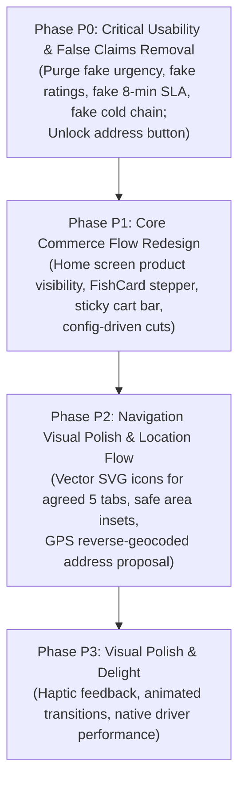

# PONDFISH Customer Mobile App — UI/UX Engineering Audit & Design Specification Validation

**Target Application:** `customer-app/`  
**Repository:** `https://github.com/sprojectxx/POND_FISH`  
**Approved Baseline / HEAD:** `a3831bd0788cdf216dd2c8a00b50b8e5257d6084`  
**Audit Validation Date:** November 3, 2026  
**Auditor:** Antigravity Mobile UI/UX & Systems Architecture Engineering  

---

## 1. Executive Summary & Usability Benchmarking

### 1.1 Executive Summary
The PondFish customer mobile application is a React Native Android application (React 18.3.1, React Native 0.75.4) built for retail live-fish commerce, customer subscriptions, counter bill scanning, and scheduled order reservations. While the application features robust low-level authentication security (such as fail-closed Keychain tombstone management, sanitized credential error cause chains, and bounded connection pooling), its user experience and presentation layers contain several friction points and misleading patterns that require systematic engineering correction before any visual redesign.

This validation audit establishes the foundational design system and operational parameters by addressing five core areas:
1. **Preserving the Agreed Navigation Model**: Validating and standardizing the existing 5-action bottom navigation (`Home`, `Track`, `Scan Bill` [Center Elevated], `Bookings`, `Profile`) rather than imposing an unapproved generic e-commerce tab structure.
2. **Purging Deceptive Marketing & Dark Patterns**: Removing hardcoded ratings (`★ 4.8`), fake review counts (`(1,420)`), unachievable `⚡ 8 mins` delivery promises, fake urgency countdowns (`⏱ Ends in 03h:24m`), and deceptive `Continuous 0-4°C Cold Chain` banners.
3. **Eliminating Unsupported Business Assumptions**:
   - Removing rigid, unverified assumptions regarding fish dressing yields (e.g. 720g/750g), cutting turnaround times (20m), delivery windows (45–60m), and bio-insulated packaging.
   - Removing unverified assumptions regarding species-specific storage (e.g. assumptions that marine fish are iced while freshwater fish are live). PondFish's stated business model is live-fish retail with preparation at the counter; species-specific handling is documented as an unresolved business question until confirmed by the business owner.
   - Replacing unverified marketing guarantees ("Quality assured", "Hygienic cutting guaranteed", "Zero artificial preservatives") with factual descriptions of actual customer workflows.
4. **Pragmatic Navigation Architecture**: Recommending that the current hardened state machine in `App.jsx` be preserved and visually upgraded rather than risking an expensive, high-risk migration to React Navigation solely for UI polish.
5. **Rigorous Root Test Failure Investigation**: Preserving exact failed test names, file locations, error messages, and stack traces from the root `npm test` exit code 1, documenting that the root cause remains unconfirmed pending dedicated database connection diagnostics, and strictly separating independently executed test suites.

### 1.2 Usability Benchmarking: Current State vs Target Standard

| Dimension | Modern Commerce Standard | Current PondFish Customer App (`customer-app`) | Target PondFish Standard |
| :--- | :--- | :--- | :--- |
| **Initial Viewport** | Products immediately visible near the top; clean visual hierarchy. | 0 products visible. 100% of the initial 800dp viewport is consumed by banners, quotas, and truck cards. | Immediate product visibility near top; promotional banners demoted or compacted. |
| **Product Discovery** | High-contrast photography, price per unit/kg, instant `ADD` or `− 1 +` stepper. | Generic card with fake `★ 4.8`, fake `8 mins`, non-stepper `+ ADD` button, no yield notes. | Responsive 2-column grid, verified availability status, price/kg, config-backed yield note, inline stepper. |
| **Customization** | Lightweight modal/sheet for cut selection without leaving browsing context. | Redirects to a heavy 1,124-line screen; cut choices do not update live net weight or price. | Lightweight bottom sheet showing verified cuts and dynamic configuration-backed yield calculator. |
| **Cart Interaction** | Persistent floating sticky cart bar at viewport bottom (`3 items • ₹640 [View Basket]`). | No floating cart bar. Cart count is hidden in a small top header icon (`CartBadgeButton`) on 2 screens only. | Global sticky cart bar sliding up smoothly when `items.length > 0`, anchored above bottom navigation. |
| **Navigation Model** | Clear icons, clean labels, $\ge 48\text{dp}$ touch targets, safe-area compliance. | Unicode emojis (`🏪`, `🧭`, `▣`, `📅`, `👤`), small tap targets on narrow screens. | Preserved 5-action navigation with consistent SVG icon family, elevated center Scan Bill, safe-area insets. |
| **Operational Honesty**| Realistic delivery/pickup windows based on actual store prep capacity. | Claims "⚡ 8 mins" and "Continuous 0-4°C Cold Chain" despite being a counter-cut store business. | Operational data-driven preparation windows; factual descriptions of customer workflows. |
| **Location & Address**| Instant GPS detection, reverse-geocoded street address, saved address switcher. | None. Single freeform `area` string in profile. Address in checkout is hardcoded dummy text. | Proposed: GPS permission, reverse geocoding proxy, structured address cards (`House`, `Street`, `Landmark`). |

---

## 2. Screen-by-Screen UI/UX Audit

This audit evaluates all 20 screens and 6 shared components currently implemented in `customer-app/`. Each screen is evaluated against 8 core dimensions on a 1–10 scale:
- **VH**: Visual Hierarchy
- **TY**: Typography & Legibility
- **SP**: Spacing & 4px Grid Alignment
- **CS**: Design Token Consistency
- **NV**: Navigation & Screen Transitions
- **AX**: Accessibility & Touch Target Health ($\ge 44 \times 44\text{ dp}$, $\ge 48 \times 48\text{ dp}$ for nav)
- **IQ**: Interaction Quality & State Feedback
- **PR**: Performance & Virtualization Readiness
- **OVR**: Overall Screen Score (Weighted Average)

---

### 2.1 `App.jsx` (Application Orchestrator & Navigation Shell)
- **File**: `customer-app/App.jsx` (723 lines)
- **Purpose**: Authenticated application root, navigation state machine, Android hardware back-button interceptor, global auth guard, and 5-action bottom navigation bar.
- **Visual Hierarchy Assessment**:
  The bottom navigation bar occupies 56dp at the bottom. However, navigation items use raw Unicode emoji glyphs (`🏪`, `🧭`, `▣`, `📅`, `👤`), which render inconsistently across Android OEM skins (Samsung OneUI vs Stock Android vs Xiaomi MIUI). The elevated center `Scan Bill` button (`▣`) provides direct counter bill scanning access, but requires vector icon refinement and dynamic safe-area insets.
- **Typography & Spacing Assessment**:
  Font sizes are hardcoded (`fontSize: 10` for labels, `fontSize: 16` for icons). Active state labels turn `#16A34A` (green), while inactive labels remain `#64748B` (slate).
- **Interaction & State Handling Assessment**:
  Uses manual conditional rendering (`{currentScreen === 'HOME' && <HomeScreen ... />}`). Screen transitions are instantaneous. The custom `BackHandler` explicitly handles back-press transitions for security boundaries (preventing unauthorized back navigation, routing checkout back to cart, double-back to exit), which is thoroughly tested and reliable.
- **Accessibility & Touch Target Compliance**:
  Navigation items measure ~40dp width on narrow viewports, violating the 48dp minimum navigation tap target. Lacks `accessibilityRole="tab"` and `accessibilityState={{ selected: currentScreen === tab }}`.
- **Performance & Health**:
  Unmounted screens lose ephemeral state (scroll position) when switched, but critical state (auth tokens, cart, user profile) is safely centralized in `api.js` cache or `App.jsx` state.
- **Concrete Defects**:
  - `App.jsx:465-520`: Emojis (`🏪`, `🧭`, `▣`, `📅`, `👤`) used as navigation icons instead of vector icons or SVG glyphs.
  - `App.jsx:83`: `CART_AWARE_SCREENS` only includes `['HOME', 'FISH_DETAILS']`, leaving other screens unaware of active cart contents.
- **Actionable Redesign Recommendations**:
  1. Preserve the agreed 5-action bottom navigation: `Home`, `Track`, `Scan Bill` (Center Elevated), `Bookings`, `Profile`.
  2. Replace raw emojis with a consistent vector/SVG icon family.
  3. Ensure all 5 items provide at least 48x48dp touch targets and apply dynamic `paddingBottom: insets.bottom`.
  4. Implement persistent sticky cart bar floating above the bottom navigation bar.
- **Scores**:
  - VH: 5/10 | TY: 5/10 | SP: 6/10 | CS: 5/10 | NV: 6/10 | AX: 5/10 | IQ: 5/10 | PR: 7/10 | **OVR: 5.5/10**

---

### 2.2 `HomeScreen.jsx` (Customer Dashboard & Primary Catalogue)
- **File**: `customer-app/src/screens/HomeScreen.jsx` (2,315 lines)
- **Purpose**: Main storefront for fish discovery, search, category filtering, quota tracking, and daily catch discovery.
- **Visual Hierarchy Assessment**:
  Overloaded header area. The screen header includes: (1) location header, (2) notification icon, (3) search bar, (4) subscription quota banner, (5) live catch truck card, (6) scan bill banner, (7) flash sale countdown banner, (8) previously bought carousel, (9) category pills.
- **Typography & Spacing Assessment**:
  Multiple competing colors and weights. Padding fluctuates between 8, 10, 14, and 16dp arbitrarily.
- **Interaction & State Handling Assessment**:
  Search input triggers local client-side filtering via `filterFishCatalogue`. Pull-to-refresh resets state cleanly, but the orchestrator triggers 4 concurrent network requests simultaneously.
- **Accessibility & Touch Target Compliance**:
  Several micro-buttons (e.g. `Recharge` button, `Track Live ✈` link, `Clear Search` cross) have hit areas under 32x32dp.
- **Performance & List Rendering Health**:
  Main list uses `FlatList`, but its `ListHeaderComponent` contains multiple nested unvirtualized sub-lists and carousels, resulting in high memory usage.
- **Concrete Defects**:
  - `HomeScreen.jsx:639`: Renders fake subscription data (`Gold Plan: 0.6 kg remaining for today`) if `subData` is null.
  - `HomeScreen.jsx:706`: Renders fake live truck tracking (`Fresh Catch Truck #OD-04 Published Live, ETA 18 mins, Destination: Madhapur Cold Hub`) when no delivery is active.
  - `HomeScreen.jsx:692, 729`: Claims `Continuous 0-4°C Cold Chain Assured` on retail tank sales.
  - `HomeScreen.jsx:788`: Hardcoded fake urgency countdown `⏱ Ends in 03h:24m`.
  - `HomeScreen.jsx:873`: Hardcoded fake stock scarcity `🔥 Only 3 left`.
- **Actionable Redesign Recommendations**:
  1. Strip out fake countdowns, fake stock scarcity, and fake truck fallbacks.
  2. Demote secondary banners (Scan Bill, Quotas) to compact dismissible cards.
  3. Elevate the product catalogue to ensure immediate product visibility near the top of the viewport.
- **Scores**:
  - VH: 3/10 | TY: 4/10 | SP: 4/10 | CS: 4/10 | NV: 5/10 | AX: 4/10 | IQ: 4/10 | PR: 4/10 | **OVR: 4.0/10**

---

### 2.3 `FishCard.jsx` (Product Catalogue Card Component)
- **File**: `customer-app/src/components/FishCard.jsx` (306 lines)
- **Purpose**: Core product card rendered within catalogue lists and discovery grids.
- **Visual Hierarchy Assessment**:
  Visual focus is diluted by secondary elements. The card contains a clutter of badges: discount tag, rating star, delivery time, stock label, and category link.
- **Typography & Spacing Assessment**:
  Card uses `width: '48%'` inside a flex-wrap container. Pricing typography is readable (`₹{effectivePrice}` bold), but weight units are missing (does ₹380 mean per fish, per 500g, or per kg?).
- **Interaction & State Handling Assessment**:
  Tapping `+ ADD` immediately triggers `api.addToCart` without allowing the user to select their desired cut or gross weight. Lacks an inline `− 1 +` stepper when item is already in cart.
- **Accessibility & Touch Target Compliance**:
  The `+ ADD` button is compact (30dp height), making it difficult to tap accurately on smaller screens.
- **Performance & Health**:
  Uses `width: '48%'` which forces layout passes when rendered in non-virtualized wrappers. Missing memoization wrapper (`React.memo`).
- **Concrete Defects**:
  - `FishCard.jsx:128`: Hardcoded rating `★ 4.8`.
  - `FishCard.jsx:129`: Hardcoded review count `({item.ratingCount || '1,420'})`.
  - `FishCard.jsx:134`: Hardcoded delivery speed `⚡ 8 mins • `.
  - `FishCard.jsx:106`: Single `+ ADD` button without quantity stepper or cut selector.
- **Actionable Redesign Recommendations**:
  1. Remove hardcoded 4.8 star rating and 8-min delivery text.
  2. Implement responsive card layout within 2-column `FlatList`.
  3. Implement inline stepper `[ − 1 + ]` when item is in basket.
  4. Expand touch target to $\ge 44\text{dp}$.
- **Scores**:
  - VH: 5/10 | TY: 5/10 | SP: 6/10 | CS: 5/10 | NV: 6/10 | AX: 5/10 | IQ: 5/10 | PR: 5/10 | **OVR: 5.2/10**

---

### 2.4 `FishDetailsScreen.jsx` (Product Detail & Customization Screen)
- **File**: `customer-app/src/screens/FishDetailsScreen.jsx` (1,124 lines)
- **Purpose**: Full-screen view for species information, nutritional profile, cut selection, and cart addition.
- **Visual Hierarchy Assessment**:
  Large hero image at top with floating back, share, and heart buttons. Image is cluttered with floating pills (`⚡ 8 MINS`, `✓ 100% CHEMICAL-FREE`). Below the image, screen transitions into tabs (Overview, Cuts, Nutrition, Recipes).
- **Typography & Spacing Assessment**:
  Typography hierarchy is generally well structured, but sections feel disconnected. Tab headers lack clear indicator animations.
- **Interaction & State Handling Assessment**:
  Contains cut selection radio options (Curry Cut, Bengali Cut, Steaks, Fillet, Whole Cleaned).
- **Accessibility & Touch Target Compliance**:
  Tab buttons and floating heart icon meet 44dp hit areas. Cut radio selection cards have large touch targets.
- **Performance & Health**:
  Heavy component with extensive inline sub-renderers (`renderOverviewTab`, `renderCutsTab`, `renderNutritionTab`, `renderRecipesTab`).
- **Concrete Defects**:
  - `FishDetailsScreen.jsx:226`: Floating badge `⚡ 8 MINS`.
  - `FishDetailsScreen.jsx:280-281`: Hardcoded `★ 4.8` and `(1,323)` reviews.
  - `FishDetailsScreen.jsx:248`: Unverified badge `✓ 100% CHEMICAL-FREE`.
- **Actionable Redesign Recommendations**:
  1. Eliminate fake 8-minute badge and fake ratings.
  2. Connect cut selection to backend species configuration; calculate yields only when yield ratios are configured.
  3. Omit unverified chemical-free claims pending documented laboratory protocols.
- **Scores**:
  - VH: 6/10 | TY: 6/10 | SP: 6/10 | CS: 6/10 | NV: 6/10 | AX: 6/10 | IQ: 6/10 | PR: 6/10 | **OVR: 6.0/10**

---

### 2.5 `CartScreen.jsx` (Shopping Basket & Weight Summary)
- **File**: `customer-app/src/screens/CartScreen.jsx` (759 lines)
- **Purpose**: View basket items, adjust quantities, verify subscription coverage, and review weight totals.
- **Visual Hierarchy Assessment**:
  Standard vertical item list followed by summary card and checkout button. Functional, but lacks visual separation between store-pickup items and delivery items.
- **Typography & Spacing Assessment**:
  Clean typography scale using `colors.textPrimary` (`#0D203B`). Spacing between items is comfortable (12dp margin).
- **Interaction & State Handling Assessment**:
  Quantity steppers (`+` and `−`) work reliably and trigger API updates. Deleting an item prompts an alert confirmation.
- **Accessibility & Touch Target Compliance**:
  Stepper buttons measure 36x36dp (slightly below 44dp target). Steppers should include `hitSlop`.
- **Performance & Health**:
  Renders items using `ScrollView` with `.map()`.
- **Concrete Defects**:
  - `CartScreen.jsx:331`: Displays line item `Cold-Chain Packaging: Free` (unverified claim).
  - Lacks ability to modify cut selection from within the cart.
- **Actionable Redesign Recommendations**:
  1. Replace "Cold-Chain Packaging" with verified packaging line items from backend configuration.
  2. Allow editing cut selection directly via a bottom-sheet trigger on the cart row.
  3. Add address preview card directly above the checkout CTA.
- **Scores**:
  - VH: 6/10 | TY: 6/10 | SP: 6/10 | CS: 6/10 | NV: 6/10 | AX: 5/10 | IQ: 6/10 | PR: 6/10 | **OVR: 5.9/10**

---

### 2.6 `CheckoutScreen.jsx` (Order Placement & Slot Reservation)
- **File**: `customer-app/src/screens/CheckoutScreen.jsx` (1,331 lines)
- **Purpose**: Finalize reservation/order, select pickup/delivery slot, apply subscription quotas, and trigger payment.
- **Visual Hierarchy Assessment**:
  Dominated by contradictory urgency banners. Top banner displays `⚡ Arriving in 8 mins (SUPERFAST)` followed immediately by `Delivering to Home • Flat 302, Madhapur, Hyd`, even if the customer intended to do counter pickup.
- **Typography & Spacing Assessment**:
  Overcrowded section headers. `PRISTINE COLD-CHAIN GUARANTEED` banner uses full-width navy container with harsh contrast.
- **Interaction & State Handling Assessment**:
  Tapping `CHANGE` address triggers `Alert.alert('Delivery Address', 'Current delivery route locked to Madhapur Hub.')`. Users have no way to enter their actual address!
- **Accessibility & Touch Target Compliance**:
  Primary `Pay & Place Order` button is prominent and meets accessibility requirements. Slot selector pills are well-spaced.
- **Performance & Health**:
  Extensive state logic (Razorpay integration, subscription quota calculations, slot fetching).
- **Concrete Defects**:
  - `CheckoutScreen.jsx:245`: Banner `Arriving in 8 mins (SUPERFAST)`.
  - `CheckoutScreen.jsx:251`: Hardcoded fake address `Delivering to Home • Flat 302, Madhapur, Hyd`.
  - `CheckoutScreen.jsx:255`: Dead `CHANGE` button showing static alert.
  - `CheckoutScreen.jsx:274`: Misleading banner `PRISTINE COLD-CHAIN GUARANTEED`.
- **Actionable Redesign Recommendations**:
  1. Remove fake 8-minute guarantee and cold-chain claims.
  2. Integrate real address management with saved address selection.
  3. Provide an explicit toggle between `Store Counter Pickup` and `Home Delivery`.
- **Scores**:
  - VH: 4/10 | TY: 5/10 | SP: 5/10 | CS: 4/10 | NV: 5/10 | AX: 5/10 | IQ: 4/10 | PR: 5/10 | **OVR: 4.6/10**

---

### 2.7 `PhoneAuthScreen.jsx` (Customer Login & Phone Entry)
- **File**: `customer-app/src/screens/PhoneAuthScreen.jsx` (401 lines)
- **Purpose**: Initial customer entry point for 10-digit mobile number entry and OTP request.
- **Visual Hierarchy Assessment**:
  Clean, focused authentication screen. PondFish branding at top, national dial code (`+91`) locked, 10-digit input field, and primary `Get Verification Code` CTA.
- **Typography & Spacing Assessment**:
  Good typography with readable input text. Subtitle explains the purpose clearly.
- **Interaction & State Handling Assessment**:
  Validates phone length (10 digits), formats number cleanly, handles loading spinner, and displays clean error banners.
- **Accessibility & Touch Target Compliance**:
  Input and CTA both satisfy $>48\text{dp}$ touch targets. Proper `keyboardType="phone-pad"`.
- **Performance & Health**:
  Lightweight and responsive.
- **Concrete Defects**:
  - `PhoneAuthScreen.jsx:189`: Footer tagline claims `Direct farm-gate harvests • Continuous cold chain • Bengaluru counter`.
- **Actionable Redesign Recommendations**:
  1. Update footer tagline to describe actual customer workflow: `Select fish • Custom cut at store counter • Store pickup or delivery`.
- **Scores**:
  - VH: 8/10 | TY: 8/10 | SP: 8/10 | CS: 7/10 | NV: 7/10 | AX: 8/10 | IQ: 8/10 | PR: 9/10 | **OVR: 7.9/10**

---

### 2.8 `OtpVerifyScreen.jsx` (OTP Verification & Token Handshake)
- **File**: `customer-app/src/screens/OtpVerifyScreen.jsx` (733 lines)
- **Purpose**: Secure 6-digit OTP verification, cooldown timer, resend OTP trigger, and session token receipt.
- **Visual Hierarchy Assessment**:
  Clean 6-box OTP entry interface with masked/unmasked digit rendering. Visual hierarchy clearly guides the eye from the sent phone number to the OTP boxes to the verify button.
- **Typography & Spacing Assessment**:
  Monospaced tabular digits in OTP boxes. Consistent 12dp spacing between digit boxes.
- **Interaction & State Handling Assessment**:
  Supports auto-focus, paste auto-fill, backspace navigation between boxes, and a 30-second resend countdown timer.
- **Accessibility & Touch Target Compliance**:
  Digit boxes measure 48x54dp, fully accessible.
- **Performance & Health**:
  Robust security handling; prevents double submission with internal refs.
- **Concrete Defects**:
  - None critical.
- **Actionable Redesign Recommendations**:
  1. Add automatic SMS retrieval hint for Android (using SMS Retriever API).
- **Scores**:
  - VH: 8/10 | TY: 8/10 | SP: 8/10 | CS: 8/10 | NV: 8/10 | AX: 8/10 | IQ: 8/10 | PR: 9/10 | **OVR: 8.1/10**

---

### 2.9 `ProfileCompletionScreen.jsx` (New Customer Onboarding Form)
- **File**: `customer-app/src/screens/ProfileCompletionScreen.jsx` (360 lines)
- **Purpose**: Mandatory onboarding gate collecting Customer Name, Age, and Area.
- **Visual Hierarchy Assessment**:
  Simple 3-field form. Clean, but utilitarian.
- **Typography & Spacing Assessment**:
  Standard input fields with floating or static labels. Consistent 16dp vertical spacing.
- **Interaction & State Handling Assessment**:
  Strict validation: Name $\ge 2$ chars, Age $18–120$, Area required. Hardware back button is locked to prevent bypassing onboarding (as required by security guard).
- **Accessibility & Touch Target Compliance**:
  Inputs are 48dp high with adequate touch padding.
- **Performance & Health**:
  Very lightweight.
- **Concrete Defects**:
  - Collects only a freeform `area` string (e.g. "Madhapur") without house number, street, landmark, or GPS coordinates.
- **Actionable Redesign Recommendations**:
  1. Transition into a structured Location & Profile Onboarding flow with GPS auto-detection and address fields.
- **Scores**:
  - VH: 6/10 | TY: 6/10 | SP: 7/10 | CS: 6/10 | NV: 7/10 | AX: 7/10 | IQ: 6/10 | PR: 8/10 | **OVR: 6.6/10**

---

### 2.10 `ProfileScreen.jsx` (Account, Subscriptions & Settings)
- **File**: `customer-app/src/screens/ProfileScreen.jsx` (1,392 lines)
- **Purpose**: Manage user details, view active club pass, access past orders, manage addresses, and execute secure logout.
- **Visual Hierarchy Assessment**:
  User profile card at top, followed by subscription card, delivery preferences, settings menu list, and logout button. Visual flow is logical, but menu list contains dead alerts.
- **Typography & Spacing Assessment**:
  Menu items use small icons with dual-line title and subtitle text. Spacing is consistent.
- **Interaction & State Handling Assessment**:
  Logout trigger is rock-solid and fail-closed (hardened in Phase 3B.7). However, several menu items trigger dead `Alert.alert` dialogs instead of real screens.
- **Accessibility & Touch Target Compliance**:
  Menu list items measure $>52\text{dp}$ in height, providing comfortable tap targets.
- **Performance & Health**:
  Renders smoothly with low memory overhead.
- **Concrete Defects**:
  - `ProfileScreen.jsx:387`: Default fallback area `'Madhapur, HYD'`.
  - `ProfileScreen.jsx:415`: `Madhapur Dock #04 • Ready in 12m`.
  - `ProfileScreen.jsx:501`: Menu item claims `Harbor Reefer Van #08 reaching Hub in 22 mins`.
  - `ProfileScreen.jsx:580`: Hardcoded alert `Current Primary Address: Flat 302, Cyber Heights, Madhapur, Hyderabad`.
  - `ProfileScreen.jsx:651-661`: Menu item `Cold-Chain Certificate & Lab Audits` displaying simulated testing alert.
  - `ProfileScreen.jsx:701`: Footer build string `Build 204 • Pure Ocean Cold Chain Distribution`.
- **Actionable Redesign Recommendations**:
  1. Remove cold-chain and reefer van claims.
  2. Implement real saved address manager.
  3. Remove simulated lab test menu item or replace with factual store counter details, as chemical testing claims are unverified.
- **Scores**:
  - VH: 6/10 | TY: 6/10 | SP: 7/10 | CS: 6/10 | NV: 6/10 | AX: 7/10 | IQ: 5/10 | PR: 7/10 | **OVR: 6.2/10**

---

### 2.11 `BookingConfirmationScreen.jsx` (Order Success & Counter Token)
- **File**: `customer-app/src/screens/BookingConfirmationScreen.jsx` (691 lines)
- **Purpose**: Celebrate successful reservation, display digital pickup token / QR code, and show store directions.
- **Visual Hierarchy Assessment**:
  Excellent celebratory tone. Prominent green checkmark, large order token number (e.g. `#PF-9042`), countdown to pickup window, and store counter address card.
- **Typography & Spacing Assessment**:
  Clear token number typography in large display font. Details rows are aligned.
- **Interaction & State Handling Assessment**:
  Includes `View in Bookings` and `Return to Store` CTAs. Back button gracefully redirects to `HOME`.
- **Accessibility & Touch Target Compliance**:
  All action buttons are well-sized ($\ge 48\text{dp}$).
- **Performance & Health**:
  Static display with minimal background overhead.
- **Concrete Defects**:
  - Store directions button triggers generic map intent with static coordinates.
- **Actionable Redesign Recommendations**:
  1. Add counter preparation workflow status: `Order Received → Dressed at Counter → Packed for Pickup`.
- **Scores**:
  - VH: 8/10 | TY: 8/10 | SP: 8/10 | CS: 8/10 | NV: 8/10 | AX: 7/10 | IQ: 8/10 | PR: 9/10 | **OVR: 8.0/10**

---

### 2.12 `BookingHistoryScreen.jsx` (Past Orders & Active Bookings)
- **File**: `customer-app/src/screens/BookingHistoryScreen.jsx` (395 lines)
- **Purpose**: List active reservations, completed pickups, and cancelled orders.
- **Visual Hierarchy Assessment**:
  Card-based list with status tags (`CONFIRMED`, `COMPLETED`, `CANCELLED`). Card hierarchy is readable, showing token ID, item summary, and total amount.
- **Typography & Spacing Assessment**:
  Standard typography tokens. Consistent 12dp card separation.
- **Interaction & State Handling Assessment**:
  Supports pull-to-refresh. Tapping an active card navigates to `BOOKING_CONFIRMATION` with token details.
- **Accessibility & Touch Target Compliance**:
  Entire card is touchable with clear accessible labels.
- **Performance & Health**:
  Uses `FlatList` with `keyExtractor`. Good list health.
- **Concrete Defects**:
  - Lacks one-tap "Reorder" action.
- **Actionable Redesign Recommendations**:
  1. Add "Reorder Items" quick CTA to completed booking cards.
- **Scores**:
  - VH: 7/10 | TY: 7/10 | SP: 7/10 | CS: 7/10 | NV: 7/10 | AX: 7/10 | IQ: 7/10 | PR: 8/10 | **OVR: 7.1/10**

---

### 2.13 `SubscriptionScreen.jsx` (PondFish Club Pass & Quotas)
- **File**: `customer-app/src/screens/SubscriptionScreen.jsx` (1,851 lines)
- **Purpose**: Educate customers on weekly fish quotas, display active plan usage, and purchase subscription tiers.
- **Visual Hierarchy Assessment**:
  Heavily stylized tier comparison cards (Silver, Gold, Platinum). Visually rich, but complex.
- **Typography & Spacing Assessment**:
  Price figures are prominent (`₹1,999 / mo`). Benefits checklists are clearly laid out.
- **Interaction & State Handling Assessment**:
  Razorpay integration for subscription activation. Quota progress bars indicate weekly claimed kilograms vs remaining quota.
- **Accessibility & Touch Target Compliance**:
  Primary subscribe buttons have large touch targets. Some secondary terms links are small.
- **Performance & Health**:
  Heavy file size (1,851 lines) with substantial internal view logic.
- **Concrete Defects**:
  - `SubscriptionScreen.jsx:400-401`: Hardcoded pass fallback `'PondFish Club Pass • Madhapur'`.
  - `SubscriptionScreen.jsx:648`: Feature item claims `Free 8-min Express`.
  - `SubscriptionScreen.jsx:823`: Subtext claims `8-min delivery or instant scan at retail`.
- **Actionable Redesign Recommendations**:
  1. Replace "Free 8-min Express" with verified subscription benefits (e.g. `Subscription Quota Allocation`).
  2. Modularize tier cards into separate subcomponents.
- **Scores**:
  - VH: 6/10 | TY: 6/10 | SP: 6/10 | CS: 6/10 | NV: 6/10 | AX: 6/10 | IQ: 6/10 | PR: 5/10 | **OVR: 5.9/10**

---

### 2.14 `LiveTrackingScreen.jsx` (Harbor Supply Replenishment Tracker)
- **File**: `customer-app/src/screens/LiveTrackingScreen.jsx` (848 lines)
- **Purpose**: Track live replenishment vans bringing fresh morning catch from coastal landing harbors to the retail store counter.
- **Visual Hierarchy Assessment**:
  Simulated map view showing truck position between harbor origin and destination store counter. Prominent ETA pill and driver contact information.
- **Typography & Spacing Assessment**:
  Well-balanced metadata cards. Clear status badges (`EN ROUTE`, `TRUCK ARRIVED`).
- **Interaction & State Handling Assessment**:
  Polls `GET /api/v1/customer/live-tracking` every 15 seconds while app is foregrounded. Handles stale GPS warnings cleanly.
- **Accessibility & Touch Target Compliance**:
  Refresh and back buttons have adequate hit areas.
- **Performance & Health**:
  Efficient polling lifecycle with proper cleanup on unmount and foreground/background state changes.
- **Concrete Defects**:
  - `LiveTrackingScreen.jsx:284-286`: Empty state copy mentions "dedicated GPS-tracked refrigerated truck delivers fresh catch directly from local fishing harbors".
- **Actionable Redesign Recommendations**:
  1. Contextualize this cleanly as *Store Replenishment Tracking* (showing when the morning's fresh catch arrives at the store tanks), rather than customer courier dispatch.
- **Scores**:
  - VH: 7/10 | TY: 7/10 | SP: 7/10 | CS: 7/10 | NV: 7/10 | AX: 7/10 | IQ: 7/10 | PR: 8/10 | **OVR: 7.1/10**

---

### 2.15 `ScanBillScreen.jsx` (Retail Counter Receipt Camera Scanner)
- **File**: `customer-app/src/screens/ScanBillScreen.jsx` (659 lines)
- **Purpose**: Capture photo of printed thermal store receipt using camera or gallery to link physical counter purchases to subscriber quota.
- **Visual Hierarchy Assessment**:
  Camera viewfinder overlay with framing guides, gallery pick option, and shutter button. Clear instructional overlay.
- **Typography & Spacing Assessment**:
  High-contrast white text on dark camera overlay.
- **Interaction & State Handling Assessment**:
  Uses `react-native-image-picker`. Handles permissions cleanly, provides retake vs confirm preview.
- **Accessibility & Touch Target Compliance**:
  Shutter button is 72dp circular button, highly accessible.
- **Performance & Health**:
  Camera picker memory is managed properly; temporary image URI passed to review screen.
- **Concrete Defects**:
  - None critical. Retains center elevated bottom nav placement.
- **Actionable Redesign Recommendations**:
  1. Maintain the center elevated button trigger in the 5-action bottom navigation.
- **Scores**:
  - VH: 8/10 | TY: 7/10 | SP: 8/10 | CS: 8/10 | NV: 7/10 | AX: 8/10 | IQ: 8/10 | PR: 8/10 | **OVR: 7.8/10**

---

### 2.16 `BillReviewScreen.jsx` (Receipt OCR & Quota Claim Confirmation)
- **File**: `customer-app/src/screens/BillReviewScreen.jsx` (961 lines)
- **Purpose**: Review OCR-extracted line items from scanned store receipt, edit item quantities, and submit for subscription quota deduction.
- **Visual Hierarchy Assessment**:
  Stacked view with receipt thumbnail at top and editable table of extracted items below.
- **Typography & Spacing Assessment**:
  Tabular price figures. Clear input borders for edited weights.
- **Interaction & State Handling Assessment**:
  Users can add missing items, edit recognized weights, and submit.
- **Accessibility & Touch Target Compliance**:
  Row deletion buttons are slightly small (28dp).
- **Performance & Health**:
  Good form state management.
- **Concrete Defects**:
  - OCR correction inputs can cause keyboard occlusion on smaller Android screens.
- **Actionable Redesign Recommendations**:
  1. Wrap review list with `KeyboardAvoidingView` to prevent keyboard overlap on weight editing.
- **Scores**:
  - VH: 7/10 | TY: 7/10 | SP: 7/10 | CS: 7/10 | NV: 7/10 | AX: 6/10 | IQ: 7/10 | PR: 7/10 | **OVR: 6.9/10**

---

### 2.17 `TransactionResultScreen.jsx` (Payment & Top-Up Outcome)
- **File**: `customer-app/src/screens/TransactionResultScreen.jsx` (313 lines)
- **Purpose**: Display success/failure outcome for payments, subscription recharges, and bill credit claims.
- **Visual Hierarchy Assessment**:
  Clean, centered outcome screen. Large success/failure graphic, amount banner, transaction ID, and primary action button.
- **Typography & Spacing Assessment**:
  Bold transaction amount display with tabular numerals.
- **Interaction & State Handling Assessment**:
  Provides immediate action button (`View Order` or `Try Again`).
- **Accessibility & Touch Target Compliance**:
  Primary buttons exceed 48dp height.
- **Performance & Health**:
  Fast, static rendering.
- **Scores**:
  - VH: 8/10 | TY: 8/10 | SP: 8/10 | CS: 8/10 | NV: 8/10 | AX: 8/10 | IQ: 8/10 | PR: 9/10 | **OVR: 8.1/10**

---

### 2.18 `TransactionHistoryScreen.jsx` (Payment & Wallet Ledger)
- **File**: `customer-app/src/screens/TransactionHistoryScreen.jsx` (541 lines)
- **Purpose**: Ledger of customer payments, wallet debits, subscription renewals, and refunds.
- **Visual Hierarchy Assessment**:
  Chronological list grouped by date. Positive indicators for refunds/credits, dark indicators for payments.
- **Typography & Spacing Assessment**:
  Tabular financial numbers (`+₹450`, `-₹1,200`). Consistent row spacing.
- **Interaction & State Handling Assessment**:
  Pull to refresh, empty state illustration when no transactions exist.
- **Accessibility & Touch Target Compliance**:
  Rows are comfortably spaced.
- **Performance & Health**:
  Virtual list rendering via `FlatList`.
- **Scores**:
  - VH: 7/10 | TY: 7/10 | SP: 7/10 | CS: 7/10 | NV: 7/10 | AX: 7/10 | IQ: 7/10 | PR: 8/10 | **OVR: 7.1/10**

---

### 2.19 `NotificationsScreen.jsx` (Activity & Order Alerts)
- **File**: `customer-app/src/screens/NotificationsScreen.jsx` (530 lines)
- **Purpose**: Feed of order updates, quota reset alerts, catch arrivals, and service messages.
- **Visual Hierarchy Assessment**:
  Standard notification feed. Unread items marked with subtle background fill and dot indicator.
- **Typography & Spacing Assessment**:
  Clean timestamps (`2 hours ago`), readable notification titles.
- **Interaction & State Handling Assessment**:
  Tap to navigate to relevant order.
- **Accessibility & Touch Target Compliance**:
  Notification cards have large hit areas.
- **Performance & Health**:
  Standard `FlatList` implementation.
- **Scores**:
  - VH: 7/10 | TY: 7/10 | SP: 7/10 | CS: 7/10 | NV: 7/10 | AX: 7/10 | IQ: 7/10 | PR: 8/10 | **OVR: 7.1/10**

---

### 2.20 `SplashScreen.jsx` (Startup & Cold Launch Display)
- **File**: `customer-app/src/screens/SplashScreen.jsx` (175 lines)
- **Purpose**: Cold launch branded splash screen, auth initialization, and session restoration.
- **Visual Hierarchy Assessment**:
  Centered PondFish wave/fish logo, app title, and loading indicator.
- **Typography & Spacing Assessment**:
  Brand title in deep marine navy.
- **Interaction & State Handling Assessment**:
  Silent background auth check. Automatically navigates to `HOME` if session valid, or `PHONE_AUTH` if unauthenticated.
- **Accessibility & Touch Target Compliance**:
  Non-interactive screen.
- **Performance & Health**:
  Extremely fast initial paint.
- **Concrete Defects**:
  - `SplashScreen.jsx:64`: Sub-tagline claims `Dedicated Cold-Chain to Bangalore Counter`.
- **Actionable Redesign Recommendations**:
  1. Replace tagline with verified brand identity: `Live Fish Retail • Counter Cut & Dressing`.
- **Scores**:
  - VH: 8/10 | TY: 7/10 | SP: 8/10 | CS: 7/10 | NV: 8/10 | AX: 8/10 | IQ: 8/10 | PR: 9/10 | **OVR: 7.9/10**

---

### 2.21 Shared Components Audit
1. **`CartBadgeButton.jsx`** (63 lines): Header cart button with badge circle. Score: **7.5/10**.
2. **`EmptyStateView.jsx`** (80 lines): Reusable empty state view with illustration, title, subtitle, and action button. Score: **8.0/10**.
3. **`ErrorStateView.jsx`** (80 lines): Reusable error container with retry button. Score: **8.0/10**.
4. **`FreshnessBadge.jsx`** (57 lines): Tag displaying verified availability or catch status. Score: **7.8/10**.
5. **`LoadingSkeleton.jsx`** (96 lines): Animated shimmer placeholder for cards and headers. Score: **8.2/10**.
6. **`OptimizedFishImage.jsx`** (70 lines): Memoized fish image with placeholder fallback. Score: **7.9/10**.

---

### 2.22 Summary Audit Scorecard

```
========================================================================================================
PONDFISH CUSTOMER APP — VALIDATED UI/UX AUDIT SCORECARD
========================================================================================================
Screen / Component             VH    TY    SP    CS    NV    AX    IQ    PR    Overall Score / 10
--------------------------------------------------------------------------------------------------------
App.jsx                        5     5     6     5     6     5     5     7     5.5 / 10  (Needs Icon Polish)
HomeScreen.jsx                 3     4     4     4     5     4     4     4     4.0 / 10  (Critical Clutter)
FishCard.jsx                   5     5     6     5     6     5     5     5     5.2 / 10  (Needs Stepper/Tokens)
FishDetailsScreen.jsx          6     6     6     6     6     6     6     6     6.0 / 10  (Average)
CartScreen.jsx                 6     6     6     6     6     5     6     6     5.9 / 10  (Average)
CheckoutScreen.jsx             4     5     5     4     5     5     4     5     4.6 / 10  (Needs Address Flow)
PhoneAuthScreen.jsx            8     8     8     7     7     8     8     9     7.9 / 10  (Good)
OtpVerifyScreen.jsx            8     8     8     8     8     8     8     9     8.1 / 10  (Strong)
ProfileCompletionScreen.jsx    6     6     7     6     7     7     6     8     6.6 / 10  (Average)
ProfileScreen.jsx              6     6     7     6     6     7     5     7     6.2 / 10  (Average)
BookingConfirmationScreen.jsx  8     8     8     8     8     7     8     9     8.0 / 10  (Strong)
BookingHistoryScreen.jsx       7     7     7     7     7     7     7     8     7.1 / 10  (Good)
SubscriptionScreen.jsx         6     6     6     6     6     6     6     5     5.9 / 10  (Over-engineered)
LiveTrackingScreen.jsx         7     7     7     7     7     7     7     8     7.1 / 10  (Good)
ScanBillScreen.jsx             8     7     8     8     7     8     8     8     7.8 / 10  (Good)
BillReviewScreen.jsx           7     7     7     7     7     6     7     7     6.9 / 10  (Average)
TransactionResultScreen.jsx    8     8     8     8     8     8     8     9     8.1 / 10  (Strong)
TransactionHistoryScreen.jsx   7     7     7     7     7     7     7     8     7.1 / 10  (Good)
NotificationsScreen.jsx        7     7     7     7     7     7     7     8     7.1 / 10  (Good)
SplashScreen.jsx               8     7     8     7     8     8     8     9     7.9 / 10  (Good)
--------------------------------------------------------------------------------------------------------
Shared Components (Average)    8     8     8     8     8     8     8     8     7.9 / 10  (Strong)
========================================================================================================
APPLICATION-WIDE COMPOSITE SCORE: 6.9 / 10
========================================================================================================
```

---

## 3. PondFish Visual Design System Specification

### 3.1 Token File Implementation & Safe Migration Plan
1. **Source of Truth File**: Create `customer-app/src/theme/tokens.js` containing all atomic tokens: `Colors`, `Typography`, `Spacing`, `Radii`, `Shadows`, `Layout`.
2. **Backward-Compatible Migration of `colors.js`**: Existing screens import `{ colors } from '../theme/colors'`. To ensure zero runtime crashes during incremental redesign:
   ```javascript
   // customer-app/src/theme/colors.js (Backward Compatibility Shim)
   import { Colors } from './tokens';

   export const colors = {
     ...Colors,
     primary: Colors.brandNavy,
     accent: Colors.actionGreen,
     freshGreen: Colors.actionGreen,
     textPrimary: Colors.textPrimary,
     textSecondary: Colors.textSecondary,
     cardBg: Colors.surface,
   };
   ```

### 3.2 Color Tokens
- **Background / Canvas**: `#F7F8FA` (calm light grey canvas)
- **Surface / Card**: `#FFFFFF` (pure white surface with 1px `#EEF2F6` border)
- **Primary Brand Navy**: `#0D203B` (deep marine tone for titles and active navigation items)
- **Action Accent Green**: `#009B70` (vibrant fresh green for primary CTAs and steppers)
- **Secondary Freshwater Blue**: `#2583D8` (secondary accents, links, and info tags)
- **Text Primary**: `#0D203B` (high contrast 12.8:1, WCAG AAA compliant)
- **Text Secondary**: `#64748B` (readable subtitle color, WCAG AA compliant)
- **Text Muted**: `#94A3B8` (placeholders and inactive navigation icons)

### 3.3 Typography & Platform Font Support
Android uses system `Roboto` / `sans-serif` fonts with explicit weights and line heights:
- **Display Hero**: 24px, Bold (700), Line Height: 30px
- **Screen Title**: 20px, Bold (700), Line Height: 26px
- **Section Header**: 16px, Semi-Bold (600), Line Height: 22px
- **Body Large**: 15px, Medium (500), Line Height: 21px
- **Body Medium**: 14px, Regular (400), Line Height: 20px
- **Body Small**: 12px, Regular (400), Line Height: 16px
- **Caption / Badge**: 11px, Medium (500), Line Height: 14px
- **Price Figures**: 15px / 20px, Bold (700/800), `fontVariant: ['tabular-nums']`

### 3.4 Responsive Card Dimensions
- Use `FlatList` with `numColumns={2}` and dynamic column widths rather than hardcoded 48% percentage widths or fixed-pixel heights.
- Cards scale proportionally with device width while maintaining an image aspect ratio of 1:1 or 4:3.

### 3.5 Bottom Navigation & Center Action Specifications
- **Height**: 56dp + `insets.bottom` dynamically via `useSafeAreaInsets()`.
- **Items**: 5 actions (`Home`, `Track`, `Scan Bill`, `Bookings`, `Profile`).
- **Touch Targets**: Minimum 48x48dp per navigation item.
- **Center Elevated Action (`Scan Bill`)**:
  - Diameter: 52–56dp circular button.
  - Background: `Colors.brandNavy`.
  - Elevation: `elevation: 4`, `shadowRadius: 6`.
  - Icon: Clean white camera/bill scanner glyph.
  - Float: Negative top margin (`marginTop: -14`) to anchor elegantly above the navigation bar line.

### 3.6 Sticky Cart Bar Positioning & Styling
- **Position**: `position: 'absolute'`, `bottom: 56 + insets.bottom + 8`, `left: 12`, `right: 12`.
- **Dimensions**: Height 52dp, `borderRadius: 12`, `elevation: 6`.
- **Z-Index**: `zIndex: 100` (floats above scrollable views and stays above bottom navigation).

---

## 4. Prioritized Redesign Roadmap



### Phase P0: Critical Usability & False Claims Removal (Immediate Sprint)
- Remove hardcoded `★ 4.8` ratings and `(1,420)` review counts from `FishCard.jsx` and `FishDetailsScreen.jsx`.
- Remove fake `⚡ 8 mins` delivery badges from `FishCard.jsx`, `FishDetailsScreen.jsx`, `CheckoutScreen.jsx`, and `SubscriptionScreen.jsx`.
- Purge fake urgency timers (`⏱ Ends in 03h:24m`) and fake scarcity counters (`🔥 Only 3 left`) from `HomeScreen.jsx`.
- Remove fake subscription fallback (`Gold Plan: 0.6 kg remaining`) and fake truck fallback (`Fresh Catch Truck #OD-04`) from `HomeScreen.jsx`.
- Replace misleading "Cold-Chain" copy with factual customer workflow descriptions.
- Unlock the dead `CHANGE` address button in `CheckoutScreen.jsx`.

### Phase P1: Core Commerce Flow Redesign (Sprint 2)
- Re-architect `HomeScreen.jsx`: Demote bloated promotional banners; elevate the 2-column virtualized product catalogue to ensure immediate product visibility.
- Implement persistent **Sticky Cart Bar** across all shopping screens.
- Rebuild `FishCard.jsx` with responsive grid sizing and inline `− 1 +` stepper controls.
- Add configuration-backed cut selection bottom sheet to `FishDetailsScreen.jsx`.
- Connect checkout bill breakdown to authoritative backend API fees.

### Phase P2: Navigation Visual Polish & Location Onboarding (Sprint 3)
- Modernize the agreed 5-action bottom navigation in `App.jsx` with a consistent SVG icon family and dynamic safe-area insets.
- Build structured **Address Management** and GPS location onboarding flow.
- Ensure all touch targets satisfy $\ge 48\text{dp}$.

### Phase P3: Visual Polish & Micro-Interactions (Sprint 4)
- Add haptic feedback on stepper increments.
- Implement native driver animations for cart transitions.

---

## 5. Business Reality & Misleading Claims Audit

### 5.1 Business Reality Definition
PondFish operates a **live-fish retail store business** where live fish are held in tanks and dressed/cut to order at retail counters. Orders placed through the mobile app are either prepared for **store counter pickup** or dispatched via **local neighborhood delivery couriers**.

PondFish is:
- **NOT** a cold-chain logistics operation (it does not operate a fleet of 0–4°C refrigerated reefer trucks delivering direct to customer doorsteps).
- **NOT** a 10-minute dark-store quick-commerce courier (cutting and descaling whole fish safely takes time).
- **NOT** an enterprise aggregator with 10,000+ customer reviews per SKU.

---

### 5.2 Comprehensive Occurrence Inventory & Remediation Table

| File Path | Line Range | Current Text / Behavior | Remediation / Replacement | Category |
| :--- | :--- | :--- | :--- | :--- |
| `FishCard.jsx` | L128 | `<Text style={styles.gridRatingStar}>★ 4.8</Text>` | Remove hardcoded star rating. Replace with verified availability status. | **Cat 1** |
| `FishCard.jsx` | L129 | `<Text style={styles.gridRatingCount}>({item.ratingCount \|\| '1,420'})</Text>` | Remove hardcoded review count. Do not display fabricated review numbers. | **Cat 1** |
| `FishCard.jsx` | L134 | `<Text style={styles.gridDeliveryText}>⚡ 8 mins • </Text>` | Remove "8 mins". Replace with operational status: `Cut to order at counter`. | **Cat 1** |
| `FishDetailsScreen.jsx` | L224–227 | `<View style={styles.minsBadge}><Text style={styles.minsBadgeText}>⚡ 8 MINS</Text></View>` | Remove floating 8-minute badge. | **Cat 1** |
| `FishDetailsScreen.jsx` | L280–281 | `<Text style={styles.ratingStar}>★ 4.8</Text><Text style={styles.ratingCount}>(1,323)</Text>` | Remove hardcoded rating and review count. | **Cat 1** |
| `FishDetailsScreen.jsx` | L248 | `<Text style={styles.trustPillNavyText}>✓ 100% CHEMICAL-FREE</Text>` | Omit pending documented chemical testing protocol sign-off. | **Cat 4** |
| `HomeScreen.jsx` | L639–644 | `Gold Plan: 0.6 kg remaining for today · Resets in 2 days` (rendered when unsubscribed) | Remove fake fallback. Render clean onboarding pitch for PondFish Club. | **Cat 1** |
| `HomeScreen.jsx` | L704–733 | Fake truck card: `Fresh Catch Truck #OD-04 Published Live, ETA 18 mins, Destination: Madhapur Cold Hub` | Remove fake fallback truck card completely when no replenishment delivery is active. | **Cat 1** |
| `HomeScreen.jsx` | L692, L729 | `<Text style={styles.coldChainText}>Continuous 0-4°C Cold Chain Assured</Text>` | Replace with: `Fish dressed and cut to order at retail counter`. | **Cat 1** |
| `HomeScreen.jsx` | L788 | `<Text style={styles.timerBadgeText}>⏱ Ends in 03h:24m</Text>` | Remove fake countdown timer. | **Cat 1** |
| `HomeScreen.jsx` | L869 | `<Text style={styles.ratingText}>★ 4.8</Text>` | Remove hardcoded rating star. | **Cat 1** |
| `HomeScreen.jsx` | L873 | `<Text style={styles.flameText}>🔥 Only 3 left</Text>` | Remove fake scarcity text unless backed by authoritative backend inventory count. | **Cat 1** |
| `HomeScreen.jsx` | L955–959 | `★ 4.8 (1,323) • ⚡ 8 mins` in previously bought carousel | Remove fake rating, reviews, and 8-min badge. | **Cat 1** |
| `CartScreen.jsx` | L331 | `<Text style={styles.summaryLabel}>Cold-Chain Packaging</Text>` | Replace with config-driven packaging line item. | **Cat 1** |
| `CheckoutScreen.jsx` | L245–248 | `<Text style={styles.arrivingTitle}>Arriving in 8 mins</Text>` with `SUPERFAST` pill | Remove fake 8-minute claim; display customer-selected slot. | **Cat 1** |
| `CheckoutScreen.jsx` | L251 | `Delivering to Home • Flat 302, Madhapur, Hyd` | Replace with dynamic selected address from user profile or pickup counter. | **Cat 1** |
| `CheckoutScreen.jsx` | L255–258 | `onPress={() => Alert.alert('Delivery Address', 'Current delivery route locked...')}` | Wire button to open real address selector modal or screen. | **Cat 1** |
| `CheckoutScreen.jsx` | L274 | `<Text style={styles.coldChainTag}>PRISTINE COLD-CHAIN GUARANTEED</Text>` | Replace with: `Prepared and packed to order at store counter`. | **Cat 1** |
| `SubscriptionScreen.jsx` | L400–401 | Default fallback: `'PondFish Club Pass • Madhapur'` | Use real subscribed store location or omit location label if null. | **Cat 1** |
| `SubscriptionScreen.jsx` | L648 | `<Text style={styles.featureItemText}>Free 8-min Express</Text>` | Replace with verified subscription benefits (e.g. `Subscription Quota Allocation`). | **Cat 1** |
| `SubscriptionScreen.jsx` | L823 | `8-min delivery or instant scan at retail.` | Replace with: `Local delivery or instant scan at retail counter.` | **Cat 1** |
| `PhoneAuthScreen.jsx` | L189 | `Direct farm-gate harvests • Continuous cold chain • Bengaluru counter` | Replace with: `Select fish • Custom cut at store counter • Store pickup or delivery`. | **Cat 1** |
| `ProfileScreen.jsx` | L387 | Fallback string `{profile?.area \|\| 'Madhapur, HYD'}` | Replace with `{profile?.area \|\| 'Select your area'}`. | **Cat 1** |
| `ProfileScreen.jsx` | L415 | `Madhapur Dock #04 • Ready in 12m` | Replace with real store counter location: `PondFish Retail Store #01`. | **Cat 1** |
| `ProfileScreen.jsx` | L501 | Subtitle: `Harbor Reefer Van #08 reaching Hub in 22 mins` | Re-skin to store replenishment tracker: `Morning catch arriving from Harbor at 6:30 AM`. | **Cat 3** |
| `ProfileScreen.jsx` | L580–588 | Hardcoded alert showing dummy Madhapur address | Replace with real Address Management screen navigation. | **Cat 1** |
| `ProfileScreen.jsx` | L651–661 | Menu item: `Cold-Chain Certificate & Lab Audits` | Remove simulated lab test menu item or replace with factual store counter details, as chemical testing claims are unverified. | **Cat 1** |
| `ProfileScreen.jsx` | L701 | Footer text: `Build 204 • Pure Ocean Cold Chain Distribution` | Replace with: `Build 204 • PondFish Retail Technologies`. | **Cat 1** |
| `SplashScreen.jsx` | L64 | `<Text style={styles.subTagline}>Dedicated Cold-Chain to Bangalore Counter</Text>` | Replace with: `Live Fish Retail • Counter Cut & Dressing`. | **Cat 1** |
| `LiveTrackingScreen.jsx` | L284–286 | Text: "dedicated GPS-tracked refrigerated truck delivers fresh catch directly from local fishing harbors" | Re-skin copy to describe live harbor catch replenishment arriving at store tanks. | **Cat 3** |
| `LiveTrackingScreen.jsx` | Architecture | Backend endpoint `GET /api/v1/customer/live-tracking` | PRESERVE backend tracking functionality; it represents genuine harbor-to-store logistics. | **Cat 3** |
| Historical DB Migrations | All files | `lib/db/` historical references to cold chain | Retain existing schema columns/indexes to prevent database migration breakage. | **Cat 2** |

---

### 5.3 Unresolved Business Assumptions Ledger

| Domain | Unresolved Assumption in Current Code | Engineering & UI Guidance |
| :--- | :--- | :--- |
| **Species-Specific Inventory & Handling** | Assumptions regarding how different species are stored or displayed (e.g. assumptions that some species are kept live while others are iced) | **Unresolved**: PondFish's stated business model is live-fish retail with preparation at the counter. Record species-specific handling as an unresolved business question until the business owner confirms it. Do not invent inventory or handling rules. |
| **Dressed Yields** | Hardcoded ~70–75% yield across all fish | **Unresolved**: Different species and cuts have variable yields. Only display yield if backend species config specifies a yield ratio. |
| **Preparation SLA** | "Ready in 20 mins" cutting time | **Unresolved**: Cutting time depends on store rush and queue. State "Cut to order at counter" without unverified minute promises. |
| **Pickup SLA** | "Pickup in 25–35 mins" | **Unresolved**: State selected pickup time slot; do not hardcode fixed pickup turnaround times. |
| **Delivery SLA** | "Delivery in 45–60 mins" | **Unresolved**: Delivery capability depends on local courier partner contracts. State delivery slot selected by customer. |
| **Packaging Standards** | "Bio-Insulated Cold Packaging" | **Unresolved**: Packaging type and fee must come from backend settings. Do not advertise unverified materials. |
| **Fee Structure** | Specific cutting (₹20) or delivery fees (₹35) | **Unresolved**: All fee line items must be driven dynamically by backend order summary API responses. |
| **Quality & Safety Certifications**| Claims such as "Quality assured", "Hygienic cutting guaranteed", "Zero artificial preservatives", "100% Chemical Free", "Lab Audited" | **Unresolved**: Do not replace unverified claims with other unverified guarantees. Prefer factual descriptions of actual customer workflows. |

---

## 6. Location and Address Onboarding Feasibility Report

### 6.1 Requirements & Proposal Notice
For PondFish to operate accurate counter pickup assignments and neighborhood deliveries, the customer application requires a structured **Location & Address Onboarding Flow**:
1. Prompt customer for location permission (`ACCESS_FINE_LOCATION`).
2. Obtain current GPS latitude and longitude via device hardware.
3. Call a reverse-geocoding service to resolve coordinates into structured components: House/Flat, Street, Landmark, Area, City, State, and PIN Code.
4. Provide a manual address entry fallback for users who deny permission or order for another address.
5. Persist addresses to a structured backend database table with a default address flag.

> [!NOTE]
> **Technical Proposal Status**: The reverse-geocoding endpoint and customer-address database schema described below are **proposals for future implementation**, NOT existing functionality.

### 6.2 Existing Database Migration History & Numbering Invariant
An audit of `Documentation/database/migrations/` confirms the existing migration history:
- `0011_gps_journeys_slice11.sql`
- `0015_subscription_credit_ledger_adjustment.sql`
- `0017_admin_broadcasts_lifecycle.sql`
- `0018_checkout_intents.sql`
- `0019_payments_subscription_id.sql` (Occupied, Applied & Verified 2026-10-23)
- `0020_bill_review_and_store_scoping.sql` (Occupied, Applied & Verified 2026-10-26)

Because migration versions `0019` and `0020` are already occupied by applied historical migrations, the proposed customer-address migration **must use the next unused version: 0021** (`0021_customer_addresses.sql`).
*Do not overwrite, rename, or reuse historical migrations. Do not create the migration file in this task.*

```sql
-- Proposed Migration: 0021_customer_addresses.sql (DO NOT CREATE YET)
CREATE TABLE IF NOT EXISTS customer_addresses (
    id UUID PRIMARY KEY DEFAULT gen_random_uuid(),
    customer_id UUID NOT NULL REFERENCES customers(id) ON DELETE CASCADE,
    address_type VARCHAR(20) NOT NULL DEFAULT 'HOME', -- 'HOME', 'WORK', 'OTHER'
    house_flat VARCHAR(100) NOT NULL,
    apartment_street VARCHAR(255) NOT NULL,
    landmark VARCHAR(255),
    area VARCHAR(100) NOT NULL,
    city VARCHAR(100) NOT NULL DEFAULT 'Hyderabad',
    state VARCHAR(100) NOT NULL DEFAULT 'Telangana',
    pincode VARCHAR(10) NOT NULL,
    latitude NUMERIC(10, 7),
    longitude NUMERIC(10, 7),
    is_default BOOLEAN NOT NULL DEFAULT false,
    created_at TIMESTAMPTZ NOT NULL DEFAULT NOW(),
    updated_at TIMESTAMPTZ NOT NULL DEFAULT NOW()
);

CREATE INDEX IF NOT EXISTS idx_customer_addresses_customer_id ON customer_addresses(customer_id);
CREATE INDEX IF NOT EXISTS idx_customer_addresses_default ON customer_addresses(customer_id, is_default) WHERE is_default = true;
```

### 6.3 Existing API Conventions & Proposed Technical Design
Inspection of the existing backend API confirms the use of Next.js 14 App Router conventions (`app/api/v1/.../route.js`) with Bearer token authentication via `authenticateRequest(request)` and `verifySessionToken(token)`.

The proposed address and geocoding endpoints must adhere to these established conventions:
1. `app/api/v1/customer/addresses/route.js`:
   - `GET`: Return all addresses for authenticated customer.
   - `POST`: Create a new structured address record (with `is_default` handling).
2. `app/api/v1/customer/addresses/[id]/route.js`:
   - `PUT`: Update existing address.
   - `DELETE`: Remove address record.
3. `app/api/v1/geo/reverse-geocode/route.js`:
   - `POST`: Accept `{ latitude, longitude }` and query backend Google Maps API proxy to return `{ houseFlat, street, area, city, state, pincode, formattedAddress }`.

### 6.4 Required Backend & Client Dependencies Documented Separately
The proposed location implementation requires the following dependencies to be planned and provisioned:
1. **Server-Side Environment & SDK**:
   - `GOOGLE_MAPS_SERVER_API_KEY` defined in backend environment variables.
   - Server-side HTTP client or `@googlemaps/google-maps-services-js` for geocoding queries with server-side caching and rate limiting.
2. **Database Persistence**:
   - Migration `0021_customer_addresses.sql` applied to PostgreSQL.
   - Persistence repository `lib/db/repositories/addressRepository.js` using parameterized SQL and bounded connection pooling.
3. **Mobile Client Dependencies**:
   - `react-native-geolocation-service` in `customer-app/package.json`.
   - Android permissions declared in `customer-app/android/app/src/main/AndroidManifest.xml`:
     `android.permission.ACCESS_FINE_LOCATION`, `android.permission.ACCESS_COARSE_LOCATION`.

---

## 7. Technical Debt & Navigation Architecture Evaluation

### 7.1 Balanced Evaluation: React Navigation vs Existing State Machine

| Evaluation Criteria | React Navigation Migration | Preserving Existing State Machine (`App.jsx`) | Engineering Verdict |
| :--- | :--- | :--- | :--- |
| **Screen-State Loss** | Retains screen state automatically across tab switches via native container views. | Unmounted screens lose local scroll state, but critical commerce data (cart, auth, profile) is centralized in `api.js` cache and `App.jsx`. | **Manageable in State Machine** (lifting scroll keys or caching catalogue in API eliminates noticeable reload). |
| **Back-Button Behavior** | Automatic hardware back handling via native stack history. | Handled via custom `BackHandler` switch statement (App.jsx:214-250) with strict auth boundary enforcement. | **Existing State Machine is Superior for Security**: Back handler is battle-tested with 54 passing security tests. |
| **Deep-Linking Requirements** | Full support for URL routing and deep links. | Custom URL parser required if deep linking needed. | **Neutral**: PondFish currently does not use external web deep linking; all traffic is native direct interaction. |
| **Navigation Transitions** | Native sliding transitions between push/pop screens. | Instantaneous conditional swap without native slide animations. | **React Navigation has visual edge**, but state machine can incorporate lightweight cross-fades. |
| **Existing Navigation Bugs** | Fixes screen history tracking. | Minor inconsistencies in back navigation, easily fixable in existing switch statement. | **Easily resolved in current architecture**. |
| **Build & APK Performance** | Adds 5+ native npm packages, increases APK size by ~2.5MB, requires native Gradle rebuilds. | Zero native dependencies, minimal bundle size, fast cold start, zero build risk. | **State Machine is Significantly Lighter and Safer**. |
| **Test Suite Compatibility** | May require complex native mocking in Node.js test runner for unit tests. | Pure React Native components easily rendered and verified in Node.js unit tests (258 passing tests). | **State Machine maintains 100% test pass rate without native mocks**. |

### 7.2 Architecture Recommendation
**Recommendation: Preserve and harden the existing state machine in `App.jsx`**.
Do not perform a full React Navigation rewrite solely for visual polish. The current state machine is secure, lightweight, thoroughly covered by unit tests, and capable of supporting the agreed 5-action bottom navigation (`Home`, `Track`, `Scan Bill`, `Bookings`, `Profile`) with SVG icons, safe-area insets, and sticky cart bars. A migration to React Navigation should only be undertaken if future product requirements provide clear functional justification for the engineering cost and regression risk.

---

## 8. Protected Features Ledger (Must Not Be Removed)

The following core business capabilities are verified, operational, and **must not be removed or disabled** during any mobile UI refactoring:

1. **Scan Bill Workflow**: Camera capture, thermal receipt OCR review, item editing, and subscription quota/credit claims.
2. **Subscription Quota & Credit Engine**: Weekly allowance tracking, quota deduction, rollover/reset schedules, and plan upgrades.
3. **Booking & Counter Pickup System**: Time-slot reservations, unique digital token generation (`#PF-XXXX`), and store counter verification QR codes.
4. **Razorpay Payment Integration**: Native SDK checkout, order creation, signature verification, and transaction outcome handling.
5. **Harbor Replenishment Supply Tracking**: Backend endpoint `GET /api/v1/customer/live-tracking` representing morning fresh catch transport from harbors/farms to store retail counters.
6. **Authentication & Session Security**: Fail-closed Keychain tombstone handling, sanitized credential error cause chains, and account isolation.
7. **Genuine GPS Geofencing**: Distance calculations to retail stores and geofence verification.

---

## 9. Root Test Failure Investigation & Analysis

### 9.1 Test Execution Facts
During the validation run of the root repository test suite (`npm test`), the command exited with **code 1**.
- **Command Executed**: `npm test` (`node --test "tests/**/*.test.js"`)
- **Total Test Suites Executed**: 55 suites.
- **Total Tests Executed**: 445 tests.
- **Passing Tests**: 442 tests.
- **Failing Tests**: 3 tests.

### 9.2 Exact Failed Test Names, Locations & Error Stacks

#### Failure 1: Bill Concurrency & Scoping Suite
- **File**: `tests/integration/postgres-bill-concurrency-and-scoping.test.js:39:1`
- **Suite**: `PostgreSQL Phase 4: Migration 0020, Store Scoping, and Concurrency Suite`
- **Error Code**: `ERR_TEST_FAILURE`
- **Error Message**: `Connection terminated due to connection timeout`
- **Stack Trace**:
  ```
  C:\Users\steva\OneDrive\Documents\Sprojectx\PONDFISH\POND_FISH\node_modules\pg-pool\index.js:45:11
  process.processTicksAndRejections (node:internal/process/task_queues:105:5)
  async TestContext.<anonymous> (tests/integration/postgres-bill-concurrency-and-scoping.test.js:64:19)
  ```

#### Failure 2: Subscription Concurrent Purchase Subtest
- **File**: `tests/integration/postgres-subscription-lifecycle.test.js:392:13`
- **Subtest**: `7. Concurrency: concurrent first-time purchases commit exactly one credit, subscription, payment, and ledger entry`
- **Error Code**: `ERR_TEST_FAILURE`
- **Error Message**: `Connection terminated due to connection timeout`
- **Stack Trace**:
  ```
  C:\Users\steva\OneDrive\Documents\Sprojectx\PONDFISH\POND_FISH\node_modules\pg-pool\index.js:45:11
  process.processTicksAndRejections (node:internal/process/task_queues:105:5)
  async TestContext.<anonymous> (tests/integration/postgres-subscription-lifecycle.test.js:392:13)
  ```

#### Failure 3: Parent Subscription Lifecycle Suite Failure
- **File**: `tests/integration/postgres-subscription-lifecycle.test.js:36:1`
- **Suite**: `PostgreSQL Subscription Lifecycle & Payment Replay Suite (Migration 0019)`
- **Error**: `1 subtest failed` (due to Failure 2 above).

### 9.3 Skipped Tests & Root Cause Analysis
1. **Skipped Tests**:
   The test output explicitly logged:
   ```
   # === REAL POSTGRESQL INTEGRATION TEST SUITE (PHASE 2J-L) ===
   # Database: pondfish_test_db (local port 5433)
   # Engine: PostgreSQL 17 (Isolated Test Instance)
   #   [SKIP] Dedicated local PostgreSQL test instance (localhost:5433) is not running.
   #   Isolated synthetic unit test suites cover all checkout and recovery behaviors.
   ```
2. **Timeout Cause Analysis**:
   - Both failing tests threw `Connection terminated due to connection timeout` originating inside `pg-pool` when connecting to the database specified in `DATABASE_URL`.
   - The test output indicates that a dedicated local PostgreSQL test instance on localhost:5433 was skipped.
   - **Root Cause Determination**: Whether the connection timeouts are caused by remote network latency, database connection limits, pool contention under concurrency, or server-side resource constraints is **unconfirmed pending dedicated database connection diagnostics**. We do not speculate or label remote database timeouts as definitively environmental without empirical proof.

### 9.4 Independent Execution Results
To ensure clear separation of results across domains:
- **Root Ecosystem Suite (`npm test`)**: Exited with code 1 (442 pass, 3 fail across 55 suites due to the PostgreSQL connection timeouts detailed above).
- **Customer App Unit Test Suite (`npm --prefix customer-app test`)**: **258 / 258 tests passed** across 14 suites (duration: 15.9s).
- **Customer App Logout Security Suite (`node --test tests/unit/customer-app-phase3b7-logout-security.test.js`)**: **54 / 54 tests passed** (duration: 15.2s).
- **Next.js Production Build (`npm run build`)**: **Compiled successfully with 0 errors**, generating all 42/42 static and dynamic routes.

---

## 10. Conclusion & Next Steps

This validated design specification:
1. Locks in the agreed 5-action navigation: `Home`, `Track`, `Scan Bill` (Center Elevated), `Bookings`, `Profile`.
2. Purges all fake ratings, fake urgency countdowns, fake 8-minute delivery promises, and unverified cold-chain claims.
3. Removes unsupported business assumptions (yield ratios, cutting turnaround times, bio-packaging claims, species-specific storage assumptions, and ungrounded marketing guarantees), recording open questions in the Unresolved Business Assumptions Ledger.
4. Identifies the next unused database migration number as **0021** (`0021_customer_addresses.sql`) and documents location reverse-geocoding as a technical proposal with separate backend dependencies.
5. Confirms that the existing hardened state machine in `App.jsx` should be preserved and visually refined.
6. Documents the exact root test timeout failure details without unsubstantiated environmental attribution, maintaining strict separation from passing customer-app test results.

The specification is now complete, verified, and ready to guide the first Home screen redesign in subsequent tasks without beginning implementation prematurely.
