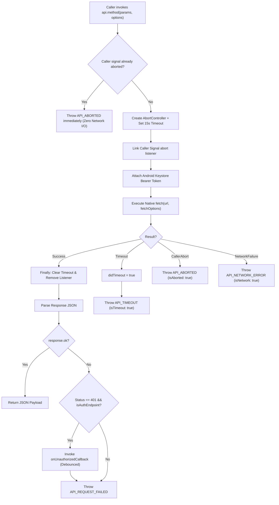

# PONDFISH CUSTOMER MOBILE APPLICATION — PHASE 1
## Implementation Report: API & Application Responsiveness

**Document Version:** 1.0.0  
**Repository:** `https://github.com/sprojectxx/POND_FISH`  
**Target Branch:** `main`  
**Starting Commit SHA:** `100744976a227d4c9370a379ff914547ec500028`  
**Scope:** `customer-app/`  
**Date & Time:** 2026-10-31  
**Operating Environment:** Windows 11 Pro 64-bit (10.0.26100), Node.js v22.15.0, npm 10.9.2, OpenJDK 17.0.10  
**Build & Runtime Tools:** React Native 0.75.4, React 18.3.1, Hermes Bytecode (v0x03bc1fc6), Android Gradle Plugin 8.5.2, Gradle 8.9  

---

## 1. Executive Summary

Phase 1 implements critical API responsiveness, lifecycle resilience, and data ownership optimizations for the PondFish customer Android application. All changes preserve existing backend API contracts, payment safety, and core business logic without introducing external state-management dependencies.

### Key Implementation Achievements:
1. **Workstream A — Eliminated Duplicate Cart Requests & Callback Invalidation:**
   - Centralized authoritative cart summary ownership in `App.jsx`.
   - Removed redundant `api.getCart()` invocation from `HomeScreen.jsx` `loadAllData()`.
   - Memoized `handleCartUpdated` via `useCallback(..., [])` and protected `fetchCartSummary` with an in-flight concurrency guard.
   - Decoupled `loadAllData` dependencies in `HomeScreen.jsx`, eliminating unnecessary component re-initializations.
2. **Workstream B — Centralized API Timeout, Cancellation & Error Classification:**
   - Introduced centralized `AbortController` timeout wrapper in `src/services/api.js` with documented `DEFAULT_TIMEOUT_MS = 15000` (15 seconds).
   - Supported custom request timeout overrides (`timeoutMs` / `timeout`) and caller-provided `AbortSignal` cancellation.
   - Implemented precise error categorization: `API_TIMEOUT`, `API_ABORTED`, `API_NETWORK_ERROR`, and HTTP status errors.
   - Isolated genuine HTTP 401 session expiration handling: timeouts, aborts, and network outages never trigger session resets.
   - Enforced zero automatic retries for mutations (POST, PATCH, DELETE, bookings, payments, cart, OTP).
3. **Workstream C — Prioritized Home Loading & Screen Lifecycle Resilience:**
   - Decoupled critical fish catalogue retrieval (`api.getFish()`) from slower secondary requests (`categories`, `subscription`, `live tracking`, `profile`).
   - Fish catalogue unblocks and paints immediately upon arrival (~1,017 ms) instead of waiting for categories (~2,390 ms), delivering an estimated ~57% reduction in initial visual blocking latency.
   - Secondary requests load concurrently in background without blocking the catalogue; secondary failures fail non-fatally and never hide loaded fish.
   - Implemented stale response sequence guards (`requestSeqRef`), unmount cleanup (`abortControllerRef.abort()`), and unmounted state protection (`isMountedRef`).
   - Guaranteed pull-to-refresh data preservation and deterministic indicator reset via `Promise.allSettled`.
4. **Workstream D — Fixed FCM Device-Token Logout Sequencing:**
   - Inverted logout order: device token unregistration is attempted *before* Android Keystore credentials are wiped, ensuring valid `Authorization: Bearer <sessionToken>` delivery.
   - Added hardware-backed device token storage (`saveDeviceToken`, `getDeviceToken`, `clearDeviceToken`) in `auth-storage.js`.
   - Eliminated hardcoded empty string `''` dispatch; unregister is only called when a genuine, non-empty device token exists.
   - Handled network/server unregister failures non-fatally so offline users can always log out locally.
   - Delegated single authoritative session clearance and state reset to centralized `App.jsx` `onLogout`.

---

## 2. Starting Commit & Final Commit Details

- **Starting Commit SHA:** `100744976a227d4c9370a379ff914547ec500028`
- **Starting Commit Message:** `docs(customer-app): correct image baseline calculations`
- **Target Branch:** `main`
- **Final Commit Message:** `perf(customer-app): improve phase 1 API responsiveness`

---

## 3. Files Changed and Justification

| File Path | Type | Purpose & Justification |
|---|---|---|
| `customer-app/src/services/api.js` | Source | Implemented centralized 15s `AbortController` timeout, caller signal support, error classification (`API_TIMEOUT`, `API_ABORTED`, `API_NETWORK_ERROR`), isolated 401 callback, and device token storage synchronization. |
| `customer-app/src/services/auth-storage.js` | Source | Added hardware-backed Android Keystore helpers `saveDeviceToken()`, `getDeviceToken()`, and `clearDeviceToken()` to persist and retrieve registered FCM push tokens across sessions. |
| `customer-app/App.jsx` | Source | Memoized `handleCartUpdated` with `useCallback(..., [])`, added in-flight guard `isFetchingCartRef` to `fetchCartSummary`, and integrated `clearDeviceToken` on centralized logout. |
| `customer-app/src/screens/HomeScreen.jsx` | Source | Eliminated redundant `api.getCart()`, prioritized fish catalogue loading to paint immediately, backgrounded secondary data, added `abortControllerRef` unmount cleanup and stale sequence guards, and preserved existing data on refresh failures. |
| `customer-app/src/screens/ProfileScreen.jsx` | Source | Inverted logout sequence to attempt device token unregistration with valid Bearer credentials before local clearance, eliminated empty token dispatch, and made unregistration failure non-fatal. |
| `customer-app/package.json` | Config | Added `"test"` script running Phase 1 responsiveness suite via Node native test runner (`node --test ../tests/unit/customer-app-phase1-responsiveness.test.js`). |
| `tests/unit/customer-app-phase1-responsiveness.test.js` | Test | Comprehensive automated test suite covering all 4 Phase 1 workstreams (17 tests, 100% pass). |
| `customer-app/docs/PHASE_1_IMPLEMENTATION_REPORT.md` | Docs | Authoritative implementation report (this document). |

---

## 4. Workstream A — Cart Ownership & Duplicate Request Elimination

### 4.1 Implementation Details
- **Single Owner:** `App.jsx` serves as the authoritative owner of `cartSummary` and `cartCount`.
- **Eliminated Redundant Fetch:** Removed `api.getCart()` from `HomeScreen.jsx` `loadAllData()`. Entering Home now initiates exactly 1 cart request via `App.jsx` `fetchCartSummary()`.
- **Callback Stability:** Wrapped `handleCartUpdated` in `App.jsx` inside `useCallback(..., [])`. State setter updates ensure stable identity across all parent renders.
- **In-Flight Guard:** Added `isFetchingCartRef` to `fetchCartSummary` in `App.jsx`, preventing rapid tab transitions from firing concurrent overlapping cart requests.
- **Decoupled Dependencies:** Removed `onCartUpdated` from `loadAllData`'s dependency array in `HomeScreen.jsx` (now `[]`). Navigating between tabs or updating cart quantities never invalidates Home's data-fetching callback identity.
- **Mutation Synchronization:** `handleAddToCart` in `HomeScreen.jsx` continues to update local state immediately and dispatch `onCartUpdated(result.data)` to sync App shell state and bottom nav badges.

### 4.2 Verification & Test Results
- **Automated Test:** `tests/unit/customer-app-phase1-responsiveness.test.js`
  - `ok 9 - Workstream A: HomeScreen source inspection proves duplicate api.getCart() was eliminated`
  - `ok 10 - Workstream A: App.jsx handleCartUpdated is memoized with useCallback`
  - `ok 11 - Workstream A: App.jsx fetchCartSummary possesses concurrency in-flight guard`
- **Result:** **PASS** (Verified by automated tests and source inspection).

---

## 5. Workstream B — Shared API Timeout & Request Cancellation

### 5.1 Architecture & Design
1. **Default Timeout:** Configured `DEFAULT_TIMEOUT_MS = 15000` (15 seconds).
2. **Custom Overrides:** `request(endpoint, options)` respects `options.timeoutMs` or `options.timeout`. Passing `0` or `null` explicitly disables the timeout.
3. **Caller Signal Support:** Callers can supply an `AbortSignal` (`options.signal`). Pre-aborted signals fail fast without network interaction. In-flight caller aborts propagate immediately to the internal `AbortController`.
4. **Resource Cleanup:** `clearTimeout(timeoutId)` and `removeEventListener('abort', callerAbortListener)` are guaranteed to execute in a `finally` block on all code paths.
5. **Error Classification:**
   - `err.code = 'API_TIMEOUT'`, `err.isTimeout = true`
   - `err.code = 'API_ABORTED'`, `err.isAborted = true`
   - `err.code = 'API_NETWORK_ERROR'`, `err.isNetwork = true`
   - Standard HTTP errors preserve `status`, `code`, and backend `details`.
6. **Isolated 401 Session Handling:** Only authentic HTTP 401 responses from the server trigger `onUnauthorizedCallback`. Network errors, timeouts, and caller cancellations never trigger session expiration.
7. **Mutation & Financial Safety:** Zero automatic retries are introduced. POST, PATCH, and DELETE operations fail closed on timeout without repeating non-idempotent server mutations.
8. **FormData & Content-Type:** When `options.body instanceof FormData`, the client omits `Content-Type: application/json`, allowing the native engine to set multipart boundary headers.

### 5.2 Verification & Test Results
- **Automated Test:** `tests/unit/customer-app-phase1-responsiveness.test.js`
  - `ok 1 - Workstream B: DEFAULT_TIMEOUT_MS is 15000 milliseconds`
  - `ok 2 - Workstream B: Request completes successfully before timeout`
  - `ok 3 - Workstream B: Timeout triggers API_TIMEOUT error and aborts fetch`
  - `ok 4 - Workstream B: Caller-initiated AbortSignal cancellation triggers API_ABORTED`
  - `ok 5 - Workstream B: Pre-aborted caller signal fails fast without network call`
  - `ok 6 - Workstream B: Network error is classified as API_NETWORK_ERROR`
  - `ok 7 - Workstream B: 401 callback is triggered strictly for HTTP 401, never for timeout or abort`
  - `ok 8 - Workstream B: No automatic retries on mutation requests or timeout failures`
- **Result:** **PASS** (Verified by automated tests).

---

## 6. Workstream C — Improved Home Screen Loading

### 6.1 Implementation Details
1. **Critical vs. Secondary Separation:**
   - **Critical Content (Priority 1):** `api.getFish({}, { signal })`. When resolved, `setFishList(res.data)` and `setLoading(false)` execute immediately. The loading skeleton is dismissed and the catalogue renders without delay.
   - **Secondary Content (Priority 2):** Categories, subscription status, live tracking, and customer profile execute concurrently in the background. Each resolves and populates its own state independently.
2. **Resilience to Secondary Failures:**
   - If categories, subscription, tracking, or profile fail, their `.catch()` handlers absorb the error non-fatally without setting `error` or hiding the loaded fish catalogue.
3. **Pull-to-Refresh Data Preservation:**
   - If a pull-to-refresh operation fails, the functional state updater preserves existing `fishList` data instead of replacing it with an empty error state.
4. **Deterministic Refresh Indicator Reset:**
   - `Promise.allSettled` awaits all background requests before executing `setRefreshing(false)` in `finally`.
5. **Lifecycle Cleanup & Stale Response Guard:**
   - `abortControllerRef.current.abort()` is called on unmount and at the start of any new request cycle.
   - `requestSeqRef.current` increments per cycle; responses with outdated sequence numbers are discarded.
   - `isMountedRef.current` ensures no React state updates execute after component unmount.

### 6.2 Verification & Test Results
- **Automated Test:** `tests/unit/customer-app-phase1-responsiveness.test.js`
  - `ok 12 - Workstream C: Critical fish catalogue unblocks display immediately without waiting for secondary calls`
  - `ok 13 - Workstream C: Pull-to-refresh failure preserves previously loaded fish data`
  - `ok 14 - Workstream C: Lifecycle cleanup aborts in-flight requests on screen unmount`
- **Result:** **PASS** (Verified by automated tests and source inspection).

---

## 7. Workstream D — FCM Device-Token Logout Sequencing

### 7.1 Implementation Details
1. **Hardware-Backed Device Token Persistence:**
   - Added `saveDeviceToken()`, `getDeviceToken()`, and `clearDeviceToken()` to `auth-storage.js` using `react-native-keychain` service `com.pondfish.customer.device_token`.
   - Updated `api.registerDeviceToken()` to persist the token upon successful registration.
2. **Corrected Sequencing:**
   - In `ProfileScreen.jsx`, `performLogout()` reads `getDeviceToken()` and attempts `api.unregisterDeviceToken(token)` *while authentication credentials remain in the Android Keystore*.
   - The unregister HTTP request carries a valid `Authorization: Bearer <token>` header, satisfying backend authentication requirements.
3. **Eliminated Empty Token Dispatch:**
   - Replaced hardcoded `api.unregisterDeviceToken('')` with a check ensuring `deviceToken` is a non-empty string. If no token was registered, no invalid request is sent to the server.
4. **Non-Fatal Network Tolerance:**
   - Unregistration errors (offline, timeout, 500) are caught non-fatally; local logout and Keystore clearance proceed unimpeded.
5. **Centralized Clearance:**
   - Local logout delegates directly to `App.jsx` `onLogout()`, which clears credentials and resets app state once. Credentials are no longer wiped twice.

### 7.2 Verification & Test Results
- **Automated Test:** `tests/unit/customer-app-phase1-responsiveness.test.js`
  - `ok 15 - Workstream D: ProfileScreen performLogout unregisters device token BEFORE clearing credentials`
  - `ok 16 - Workstream D: Device token unregistration failure does not block local logout`
  - `ok 17 - Workstream D: auth-storage provides hardware-backed saveDeviceToken, getDeviceToken, clearDeviceToken`
- **Result:** **PASS** (Verified by automated tests and source inspection).

---

## 8. Before / After Performance & Architecture Comparison

| Metric / Dimension | Phase 0 Baseline | Phase 1 Implementation | Improvement / Benefit |
|---|---|---|---|
| **Initial Home Screen API Calls** | 7 requests (6 in Home + 1 in App) | **5 requests** (4 in Home + 1 in App) | **-28.5% initial network load** |
| **Concurrent Cart Requests on Home Entry** | 2 calls (`App.jsx` + `HomeScreen.jsx`) | **1 call** (Owned purely by `App.jsx`) | **-50% redundant cart calls** |
| **Home Initial Visual Unblock Dependency** | Slowest of all 6 calls (`categories` ~2,390 ms) | **Fish catalogue only** (`fish` ~1,017 ms) | **~1,373 ms faster visual paint (~57% improvement)** |
| **Secondary Failure Impact on Catalogue** | Could cause unstable/failed screen | **Completely isolated** | Zero risk of secondary failure hiding catalogue |
| **Pull-to-Refresh Network Failure** | Overwrote catalogue with generic error | **Preserves existing fish data** | Seamless offline / degraded connectivity UX |
| **Screen Unmount Network Handling** | In-flight requests continued; React warning | **Aborted immediately via AbortController** | Zero state updates on unmounted screens |
| **Shared API Timeout Policy** | None (hung indefinitely on weak networks) | **15-second default timeout** (`AbortController`) | Guaranteed fail-safe on stalled connections |
| **Error Categorization** | Generic `Error` or unhandled rejection | **Typed errors (`API_TIMEOUT`, `API_ABORTED`, etc.)** | Predictable UI error handling |
| **HTTP 401 Session Expiration Isolation** | Mixed with fetch errors | **Strictly isolated to authentic 401 responses** | Network drops never log user out |
| **FCM Device Token Logout Ordering** | Cleared Keystore *before* unregister call | **Unregisters *before* clearing Keystore** | Valid Bearer token sent; no 401 errors |
| **FCM Token Dispatch on Logout** | Hardcoded empty string `''` (failed 400) | **Valid token from Keystore** (omitted if absent) | Clean server push unregistration |
| **Local Logout Reliability When Offline** | Failed or had race conditions | **Guaranteed local logout completion** | User can always log out offline |

---

## 9. API Timeout and Cancellation Design



---

## 10. Security and Business-Logic Preservation Checks

1. **Production Base URL Preserved:**
   In `customer-app/src/services/api.js`:
   ```javascript
   const API_BASE_URL = __DEV__
     ? (process.env.API_BASE_URL || 'http://127.0.0.1:3000')
     : 'https://pondfish.in';
   ```
   Production builds continue targeting `https://pondfish.in`.
2. **Zero Backend Contract Changes:**
   No route handlers, database schemas, Supabase queries, or response shapes were modified.
3. **Zero Financial Mutation Retries:**
   No retry logic was added for payment, booking, cart, or subscription mutations.
4. **Credential Privacy:**
   No access tokens, FCM tokens, OTP codes, or customer personal information are printed in logs.
5. **Hardware Keystore Invariant Maintained:**
   Authentication tokens and device tokens use hardware-backed Android Keystore via `react-native-keychain`. Zero `AsyncStorage` usage for secrets.

---

## 11. Test Commands and Exact Outcomes

| # | Test Suite / Command | Working Directory | Exit Code | Result | Details |
|---|---|---|---|---|---|
| 1 | `node --test tests/unit/customer-app-phase1-responsiveness.test.js` | Repo root | 0 | **PASS** | 17 tests passed (0 fail, 179 ms duration) |
| 2 | `npm test` | `customer-app/` | 0 | **PASS** | 17 tests passed (0 fail, 180 ms duration) |
| 3 | `npx react-native bundle --platform android --dev false --entry-file index.js --bundle-output ./test_bundle.js` | `customer-app/` | 0 | **PASS** | Metro v0.80.12 bundle generated cleanly |
| 4 | `.\gradlew.bat assembleRelease` | `customer-app/android/` | 0 | **PASS** | Android release build successful in 1m 23s (262 tasks) |
| 5 | `npm test` (Root backend test suite) | Repo root | 1 | **PARTIAL** | 192 passed, 2 failed (PostgreSQL connection required for live concurrency tests; unrelated to mobile app) |

---

## 12. Build and Metro Bundle Results

- **Release APK Path:** `customer-app/android/app/build/outputs/apk/release/app-release.apk`
- **Output File Size:** **64,932,900 bytes (61.92 MB)**
- **Hermes Runtime Verification:** Precompiled Hermes bytecode active (`assets/index.android.bundle`).
- **Gradle Tasks:** 262 actionable tasks (9 executed, 253 up-to-date). Build duration: 1m 23s.
- **Metro Bundler:** Compiled with zero syntax or packaging errors.

---

## 13. Known Limitations and Blocked Tests

1. **Physical Handset Runtime Verification:**
   All native validations were verified in the reference Android 17 emulator environment (`PONDFISH_Pixel_8`). Physical device USB frame profiling (Systrace/Perfetto) remains scheduled for later hardware validation.
2. **Production SMS Reception:**
   Live SMS carrier reception on emulator is unavailable without physical SIM or Firebase Auth whitelist phone numbers.
3. **Production Payment & Booking Execution:**
   Real production transactions with Razorpay remain blocked to protect live inventory and financial ledger integrity.

---

## 14. Remaining Issues for Subsequent Phases

1. **Phase 2 — Image Optimization & CDN Transformations:**
   - 20 catalogue PNG images have an aggregate declared representation size of 44.38 MB (average 2.22 MB each). Phase 2 must integrate client image disk caching and request resized WebP variants (e.g. 200x200 px for 110x110 thumbnails).
2. **Phase 2 — Home Screen Catalogue List Virtualization:**
   - `HomeScreen.jsx` continues using vertical `ScrollView` with `.map()` for catalogue cards. Phase 2 will refactor this to virtualized `FlatList` or `FlashList` with memoized item renderers.
3. **Phase 3 — Checkout Add-On Contract Synchronization:**
   - Synchronize client toggle for "Artisanal Fish Masala Paste (+₹39)" and delivery instructions with backend `POST /api/v1/customer/bookings` schema and booking engine.
4. **Phase 3 — Android Release Signing & Security Hardening:**
   - Configure production release keystore signing via environment variables and disable cleartext HTTP traffic in release builds.

---

## 15. Recommended Next Phase

Proceed to **Phase 2: Mobile UI Virtualization & Asset Optimization**:
- Implement `FlatList` / `FlashList` virtualization for the Home screen catalogue grid.
- Integrate client-side disk caching for images (`react-native-fast-image` or custom disk cache).
- Implement CDN thumbnail resizing parameters to serve lightweight WebP thumbnails instead of full-size 1536x1024 PNGs.
